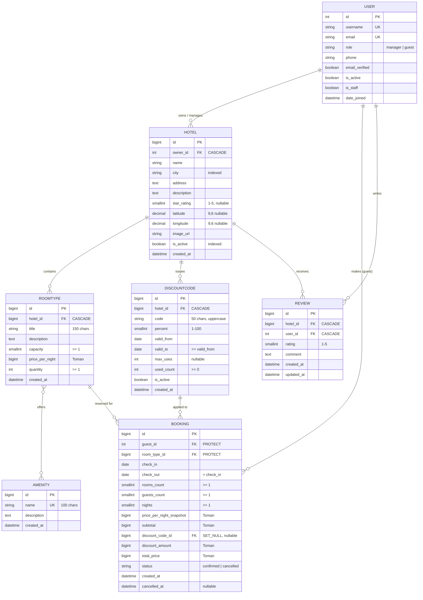

# DATA MODEL (Finalised v1.0 — Phase 1; changes via /pair-contract)

> Single source of truth for database schemas, constraints, relations, and business invariants.
> All fields, data types, indexes, and constraints documented below match the Django models in `backend/apps/`.

---

## 1. Entity-Relationship Diagram (ERD)

---

## 2. Models Specification

### 2.1 `accounts.User`
- **Table Name:** `accounts_user`
- **Base Class:** `django.contrib.auth.models.AbstractUser`
- **Manager:** `apps.accounts.models.UserManager` (auto-assigns default roles)

| Field | Django Type | DB / PostgreSQL Type | Null / Blank | Default | Constraints & Validators | Notes |
|---|---|---|---|---|---|---|
| `id` | `AutoField` | `integer` | `False / False` | Auto | PK | Primary Key |
| `username` | `CharField(150)` | `varchar(150)` | `False / False` | – | Unique, standard regex | AbstractUser standard |
| `first_name` | `CharField(150)` | `varchar(150)` | `False / True` | `""` | – | AbstractUser standard |
| `last_name` | `CharField(150)` | `varchar(150)` | `False / True` | `""` | – | AbstractUser standard |
| `email` | `EmailField` | `varchar(254)` | `False / False` | – | `unique=True` | Unique required email |
| `role` | `CharField(20)` | `varchar(20)` | `False / False` | `'guest'` | Choices: `manager`, `guest` | User system role |
| `phone` | `CharField(20)` | `varchar(20)` | `False / True` | `""` | – | Contact phone number |
| `email_verified` | `BooleanField` | `boolean` | `False / False` | `False` | – | Email verification flag |
| `is_staff` | `BooleanField` | `boolean` | `False / False` | `False` | – | Admin access flag |
| `is_active` | `BooleanField` | `boolean` | `False / False` | `True` | – | Account active status |
| `date_joined` | `DateTimeField` | `timestamptz` | `False / False` | `now` | – | Registration timestamp |

- **Meta Configuration:**
  - `ordering = ["id"]`
  - `verbose_name = "user"` / `verbose_name_plural = "users"`
- **Helpers / Properties:**
  - `is_manager`: returns `self.role == User.Role.MANAGER`
  - `is_guest`: returns `self.role == User.Role.GUEST`

---

### 2.2 `hotels.Amenity`
- **Table Name:** `hotels_amenity`
- **Purpose:** Standalone catalogue of features/amenities (e.g., WiFi, Breakfast, Parking, Pool).

| Field | Django Type | DB / PostgreSQL Type | Null / Blank | Default | Constraints & Validators | Notes |
|---|---|---|---|---|---|---|
| `id` | `BigAutoField` | `bigint` | `False / False` | Auto | PK | Primary Key |
| `name` | `CharField(100)` | `varchar(100)` | `False / False` | – | `unique=True` | Unique amenity name |
| `description` | `TextField` | `text` | `False / True` | `""` | – | Optional description |
| `created_at` | `DateTimeField` | `timestamptz` | `False / False` | Auto now add | – | Creation timestamp |

- **Meta Configuration:**
  - `ordering = ["name"]`
  - `verbose_name = "amenity"` / `verbose_name_plural = "amenities"`

---

### 2.3 `hotels.Hotel`
- **Table Name:** `hotels_hotel`
- **Purpose:** Hotel establishment registered and managed by a manager user.

| Field | Django Type | DB / PostgreSQL Type | Null / Blank | Default | Constraints & Validators | Notes |
|---|---|---|---|---|---|---|
| `id` | `BigAutoField` | `bigint` | `False / False` | Auto | PK | Primary Key |
| `owner` | `ForeignKey(User)` | `integer` | `False / False` | – | `on_delete=CASCADE`, `related_name="hotels"` | Hotel manager |
| `name` | `CharField(255)` | `varchar(255)` | `False / False` | – | – | Hotel name |
| `city` | `CharField(100)` | `varchar(100)` | `False / False` | – | `db_index=True` | Indexed city name |
| `address` | `TextField` | `text` | `False / False` | – | – | Full street address |
| `description` | `TextField` | `text` | `False / True` | `""` | – | Detailed overview |
| `star_rating` | `PositiveSmallIntegerField` | `smallint` | `True / True` | `None` | `MinValueValidator(1)`, `MaxValueValidator(5)` | 1 to 5 stars (optional) |
| `latitude` | `DecimalField(9, 6)` | `numeric(9,6)` | `True / True` | `None` | – | Coordinates for maps |
| `longitude` | `DecimalField(9, 6)` | `numeric(9,6)` | `True / True` | `None` | – | Coordinates for maps |
| `image_url` | `URLField(500)` | `varchar(500)` | `False / True` | `""` | – | Main photo link |
| `is_active` | `BooleanField` | `boolean` | `False / False` | `True` | – | Listed / active flag |
| `created_at` | `DateTimeField` | `timestamptz` | `False / False` | Auto now add | – | Registration timestamp |

- **Meta Configuration:**
  - `ordering = ["-created_at"]`
  - `indexes`:
    - `hotel_city_idx` on `["city"]`
    - `hotel_is_active_idx` on `["is_active"]`
  - `constraints`:
    - `hotel_star_rating_1_to_5`: `CheckConstraint(check=Q(star_rating__gte=1, star_rating__lte=5) | Q(star_rating__isnull=True))`

---

### 2.4 `hotels.RoomType`
- **Table Name:** `hotels_roomtype`
- **Purpose:** Room category defined within a hotel with specific capacity, pricing, and amenities.

| Field | Django Type | DB / PostgreSQL Type | Null / Blank | Default | Constraints & Validators | Notes |
|---|---|---|---|---|---|---|
| `id` | `BigAutoField` | `bigint` | `False / False` | Auto | PK | Primary Key |
| `hotel` | `ForeignKey(Hotel)` | `bigint` | `False / False` | – | `on_delete=CASCADE`, `related_name="room_types"` | Owning hotel |
| `title` | `CharField(150)` | `varchar(150)` | `False / False` | – | – | e.g. Deluxe Double |
| `description` | `TextField` | `text` | `False / True` | `""` | – | Layout/room details |
| `capacity` | `PositiveSmallIntegerField` | `smallint` | `False / False` | `1` | `MinValueValidator(1)` | Max guests per room |
| `price_per_night` | `PositiveBigIntegerField` | `bigint` | `False / False` | – | – | Nightly price in Toman |
| `quantity` | `PositiveIntegerField` | `integer` | `False / False` | `1` | `MinValueValidator(1)` | Physical room stock |
| `amenities` | `ManyToManyField(Amenity)` | Join Table | `False / True` | Empty | `related_name="room_types"` | Room features |
| `created_at` | `DateTimeField` | `timestamptz` | `False / False` | Auto now add | – | Creation timestamp |

- **Meta Configuration:**
  - `ordering = ["hotel", "price_per_night"]`
  - `constraints`:
    - `unique_hotel_roomtype_title`: `UniqueConstraint(fields=["hotel", "title"])`
    - `roomtype_capacity_gte_1`: `CheckConstraint(check=Q(capacity__gte=1))`
    - `roomtype_quantity_gte_1`: `CheckConstraint(check=Q(quantity__gte=1))`

---

### 2.5 `bookings.DiscountCode`
- **Table Name:** `bookings_discountcode`
- **Purpose:** Promotional coupon percentage issued by a hotel manager for their hotel.

| Field | Django Type | DB / PostgreSQL Type | Null / Blank | Default | Constraints & Validators | Notes |
|---|---|---|---|---|---|---|
| `id` | `BigAutoField` | `bigint` | `False / False` | Auto | PK | Primary Key |
| `hotel` | `ForeignKey(Hotel)` | `bigint` | `False / False` | – | `on_delete=CASCADE`, `related_name="discount_codes"` | Hotel offering coupon |
| `code` | `CharField(50)` | `varchar(50)` | `False / False` | – | Auto uppercase on save | Coupon code |
| `percent` | `PositiveSmallIntegerField` | `smallint` | `False / False` | – | `MinValueValidator(1)`, `MaxValueValidator(100)` | 1 to 100 percent |
| `valid_from` | `DateField` | `date` | `False / False` | – | – | Start date (inclusive) |
| `valid_to` | `DateField` | `date` | `False / False` | – | – | End date (inclusive) |
| `max_uses` | `PositiveIntegerField` | `integer` | `True / True` | `None` | Nullable (unlimited) | Max redemptions count |
| `used_count` | `PositiveIntegerField` | `integer` | `False / False` | `0` | – | Current redemptions count |
| `is_active` | `BooleanField` | `boolean` | `False / False` | `True` | – | Active coupon flag |
| `created_at` | `DateTimeField` | `timestamptz` | `False / False` | Auto now add | – | Creation timestamp |

- **Meta Configuration:**
  - `ordering = ["-created_at"]`
  - `constraints`:
    - `unique_hotel_discount_code`: `UniqueConstraint(fields=["hotel", "code"])`
    - `discount_percent_1_to_100`: `CheckConstraint(check=Q(percent__gte=1, percent__lte=100))`
    - `discount_valid_to_gte_valid_from`: `CheckConstraint(check=Q(valid_to__gte=F("valid_from")))`
    - `discount_used_count_gte_0`: `CheckConstraint(check=Q(used_count__gte=0))`

---

### 2.6 `bookings.Booking`
- **Table Name:** `bookings_booking`
- **Purpose:** Financial and reservation record of a guest reserving rooms of a specific `RoomType`.

| Field | Django Type | DB / PostgreSQL Type | Null / Blank | Default | Constraints & Validators | Notes |
|---|---|---|---|---|---|---|
| `id` | `BigAutoField` | `bigint` | `False / False` | Auto | PK | Primary Key |
| `guest` | `ForeignKey(User)` | `integer` | `False / False` | – | `on_delete=PROTECT`, `related_name="bookings"` | Reserving guest user |
| `room_type` | `ForeignKey(RoomType)` | `bigint` | `False / False` | – | `on_delete=PROTECT`, `related_name="bookings"` | Reserved room type |
| `check_in` | `DateField` | `date` | `False / False` | – | – | Check-in date |
| `check_out` | `DateField` | `date` | `False / False` | – | – | Check-out date |
| `rooms_count` | `PositiveSmallIntegerField` | `smallint` | `False / False` | `1` | `MinValueValidator(1)` | Number of rooms booked |
| `guests_count` | `PositiveSmallIntegerField` | `smallint` | `False / False` | `1` | `MinValueValidator(1)` | Total guests staying |
| `nights` | `PositiveSmallIntegerField` | `smallint` | `False / False` | Auto computed | `nights = (check_out - check_in).days` | Duration in nights |
| `price_per_night_snapshot` | `PositiveBigIntegerField` | `bigint` | `False / False` | – | Stored at reservation | Price snapshot (Toman) |
| `subtotal` | `PositiveBigIntegerField` | `bigint` | `False / False` | – | `rooms_count * nights * price_snapshot` | Base total price (Toman) |
| `discount_code` | `ForeignKey(DiscountCode)` | `bigint` | `True / True` | `None` | `on_delete=SET_NULL`, `related_name="bookings"` | Applied coupon |
| `discount_amount` | `PositiveBigIntegerField` | `bigint` | `False / False` | `0` | Calculated discount | Total deducted (Toman) |
| `total_price` | `PositiveBigIntegerField` | `bigint` | `False / False` | – | `subtotal - discount_amount` | Final price (Toman) |
| `status` | `CharField(20)` | `varchar(20)` | `False / False` | `'confirmed'` | Choices: `confirmed`, `cancelled` | Booking status |
| `created_at` | `DateTimeField` | `timestamptz` | `False / False` | Auto now add | – | Reservation timestamp |
| `cancelled_at` | `DateTimeField` | `timestamptz` | `True / True` | `None` | Nullable | Cancellation timestamp |

- **Meta Configuration:**
  - `ordering = ["-created_at"]`
  - `indexes`:
    - `booking_rt_dates_idx` on `["room_type", "check_in", "check_out"]`
    - `booking_guest_status_idx` on `["guest", "status"]`
    - `booking_status_idx` on `["status"]`
  - `constraints`:
    - `booking_check_out_gt_check_in`: `CheckConstraint(check=Q(check_out__gt=F("check_in")))`
    - `booking_rooms_count_gte_1`: `CheckConstraint(check=Q(rooms_count__gte=1))`
    - `booking_guests_count_gte_1`: `CheckConstraint(check=Q(guests_count__gte=1))`
    - `booking_nights_gte_1`: `CheckConstraint(check=Q(nights__gte=1))`

---

### 2.7 `reviews.Review` (Bonus Feature)
- **Table Name:** `reviews_review`
- **Purpose:** Guest ratings and feedback on hotels (1 to 5 stars + optional comment).

| Field | Django Type | DB / PostgreSQL Type | Null / Blank | Default | Constraints & Validators | Notes |
|---|---|---|---|---|---|---|
| `id` | `BigAutoField` | `bigint` | `False / False` | Auto | PK | Primary Key |
| `hotel` | `ForeignKey(Hotel)` | `bigint` | `False / False` | – | `on_delete=CASCADE`, `related_name="reviews"` | Hotel receiving review |
| `user` | `ForeignKey(User)` | `integer` | `False / False` | – | `on_delete=CASCADE`, `related_name="reviews"` | User writing review |
| `rating` | `PositiveSmallIntegerField` | `smallint` | `False / False` | – | `MinValueValidator(1)`, `MaxValueValidator(5)` | 1 to 5 stars |
| `comment` | `TextField` | `text` | `False / True` | `""` | – | Review feedback text |
| `created_at` | `DateTimeField` | `timestamptz` | `False / False` | Auto now add | – | Creation timestamp |
| `updated_at` | `DateTimeField` | `timestamptz` | `False / False` | Auto now | – | Last update timestamp |

- **Meta Configuration:**
  - `ordering = ["-created_at", "-id"]`
  - `constraints`:
    - `unique_hotel_user_review`: `UniqueConstraint(fields=["hotel", "user"])`
    - `review_rating_1_to_5`: `CheckConstraint(check=Q(rating__gte=1, rating__lte=5))`

---

## 3. تحلیل تفصیلی روابط و منطق رفتارهای `on_delete` (فارسی / دفاعیه)

در طراحی پایگاه‌داده سامانه رزرو هتل، انتخاب رفتار حذف کلید خارجی (`on_delete`) با هدف **حفظ یکپارچگی داده‌ها (Data Integrity)**، **جلوگیری از فساد اسناد مالی (Financial Auditability)** و **حذف رکوردهای هرز و بدون صاحب (Preventing Orphaned Rows)** صورت گرفته است. جدول زیر و پاراگراف‌های تشریحی آن، منطق مهندسی هر رابطه را توضیح می‌دهند:

| رابطه | مدل مبدأ | فیلد کلید خارجی | مدل مقصد | سیاست `on_delete` | نام رابطه معکوس (`related_name`) |
|---|---|---|---|---|---|
| ۱ | `Hotel` | `owner` | `User` | `CASCADE` | `hotels` |
| ۲ | `RoomType` | `hotel` | `Hotel` | `CASCADE` | `room_types` |
| ۳ | `RoomType` | `amenities` | `Amenity` | (M2M Table) | `room_types` |
| ۴ | `DiscountCode` | `hotel` | `Hotel` | `CASCADE` | `discount_codes` |
| ۵ | `Booking` | `guest` | `User` | `PROTECT` | `bookings` |
| ۶ | `Booking` | `room_type` | `RoomType` | `PROTECT` | `bookings` |
| ۷ | `Booking` | `discount_code` | `DiscountCode` | `SET_NULL` | `bookings` |
| ۸ | `Review` | `hotel` | `Hotel` | `CASCADE` | `reviews` |
| ۹ | `Review` | `user` | `User` | `CASCADE` | `reviews` |

### تشریح منطق هر رابطه و چرایی انتخاب سیاست‌های حذف:

1. **رابطه `Hotel.owner -> User` با سیاست `CASCADE`:**
   مالکیت هتل یک مفهوم وجودی وابسته به کاربر مدیر (Manager) است. هر هتل باید دقیقاً یک مدیر مشخص داشته باشد. در صورت حذف قطعی حساب کاربری یک مدیر از سیستم، هتل‌های تحت مدیریت او نیز به صورت آبشاری حذف می‌شوند. البته به دلیل وجود قید `PROTECT` روی رزروها، در صورتی که هتل دارای رزروهای ثبت‌شده باشد، دیتابیس به صورت خودکار مانع از حذف کل مجموعه می‌شود تا امنیت مالی حفظ گردد.

2. **رابطه `RoomType.hotel -> Hotel` با سیاست `CASCADE`:**
   نوع اتاق (`RoomType`) یک موجودیت ضعیف (Weak Entity) نسبت به هتل است و خارج از زمینه هتل فاقد معنا و هویت مستقل است. بنابراین با حذف یک هتل، تمامی انواع اتاق‌های وابسته به آن باید بدون بر جا گذاشتن رکوردهای رهاشده (`Orphaned Records`) به طور خودکار پاک شوند.

3. **رابطه چند-به-چند `RoomType.amenities <-> Amenity`:**
   امکانات رفاهی (مانند وای‌فای، استخر، پارکینگ) بین انواع اتاق‌های مختلف در هتل‌های گوناگون به اشتراک گذاشته می‌شوند. حذف یک نوع اتاق تنها پیوندهای مربوطه را در جدول واسط (`hotels_roomtype_amenities`) حذف می‌کند و آسیبی به رکورد اصلی امکان رفاهی وارد نمی‌سازد.

4. **رابطه `DiscountCode.hotel -> Hotel` با سیاست `CASCADE`:**
   کدهای تخفیف به طور اختصاصی توسط مدیر یک هتل و صرفاً برای همان هتل صادر می‌شوند (با قید یکتایی کد در سطح هتل). در نتیجه حیات یک کد تخفیف کاملاً وابسته به هتل صادرکننده آن است و با حذف هتل، کدهای تخفیف تعریف‌شده برای آن نیز حذف می‌شوند.

5. **رابطه `Booking.guest -> User` با سیاست حیاتی `PROTECT`:**
   رکورد رزرو در یک سامانه هتلداری یک **سند مالی، حقوقی و تاریخی** است. اگر یک کاربر مسافر اقدام به رزرو هتل کرده باشد، حساب کاربری او تحت هیچ شرایطی نباید بتواند از پایگاه داده فیزیکی حذف شود و موجب بروز خطای رکوردهای مالی بدون کاربر گردد (`ProtectedError` صادر می‌شود). در سیستم‌های تجاری، به جای حذف سخت (`Hard Delete`)، حساب کاربری با تنظیم `is_active=False` غیرفعال می‌شود تا تاریخچه و اسناد مالی رزروها مخدوش نشود.

6. **رابطه `Booking.room_type -> RoomType` با سیاست حیاتی `PROTECT`:**
   مشابه رابطه با کاربر، یک نوع اتاق که دارای سابقه رزرو قبلی یا رزروهای جاری است نباید حذف شود؛ زیرا حذف آن موجب پاک شدن یا معلق ماندن جزئیات اقامت و محاسبات مالی مهمانان خواهد شد. در صورت نیاز به خارج کردن یک نوع اتاق از چرخه فروش، تعداد موجودی (`quantity`) صفر شده یا غیرفعال می‌شود و رکوردهای دیتابیس محفوظ می‌مانند.

7. **رابطه `Booking.discount_code -> DiscountCode` با سیاست هوشمند `SET_NULL`:**
   کد تخفیف یک فیلد ارجاعی اختیاری (`nullable`) روی رزرو است. هنگامی که یک رزرو ثبت می‌شود، تمامی مبالغ مالی (`price_per_night_snapshot`, `subtotal`, `discount_amount`, `total_price`) به صورت دقیق اسنپ‌شات و ذخیره می‌شوند. اگر هتل پس از پایان دوره یک کمپین تبلیغاتی، رکورد کد تخفیف را پاک کند، رزروهای پیشین نباید لغو شده یا حذف شوند؛ بلکه صرفاً فیلد ارجاعی `discount_code_id` به مقدار `NULL` تغییر می‌یابد و جزئیات تخفیف و مبلغ نهایی در فیلدهای اسنپ‌شات‌شده رزرو کاملاً استوار و پایدار می‌مانند.

8. **رابطه‌های `Review.hotel` و `Review.user` با سیاست `CASCADE`:**
   نظرات و امتیازات کاربران محتوای بازخوردی جانبی هستند. با حذف یک هتل یا حذف حسابی که نظر را ثبت کرده است، نظرات ثبت‌شده نیز به صورت خودکار حذف می‌شوند، زیرا نمایش نظر برای هتلی که وجود خارجی ندارد یا نظری که هویت نویسنده آن پاک شده است ارزش معنایی ندارد و نباید فضای پایگاه داده را بیهوده اشغال کند.

---

## 4. قوانین کسب‌وکار و پایگاه داده (Business Invariants)

1. **انطباق ظرفیت مهمانان (Capacity Rule):**
   `guests_count <= room_type.capacity * rooms_count`
   تعداد مهمانان انتخاب‌شده توسط کاربر نمی‌تواند از مجموع ظرفیت کل اتاق‌های درخواست‌شده بیشتر باشد.

2. **قانون بازه زمانی اقامت (Date Range Invariant):**
   قید دیتابیسی `booking_check_out_gt_check_in` تضمین می‌کند که تاریخ خروج (`check_out`) اکیداً پس از تاریخ ورود (`check_in`) باشد (حداقل یک شب اقامت).

3. **محاسبه موجودی و ظرفیت خالی (Availability Calculation - D-006):**
   تنها رزروهای با وضعیت `confirmed` ظرفیت اتاق‌ها را اشغال می‌کنند. در هر روز تقویمی در بازه اقامت، مجموع اتاق‌های رزروشده برای یک نوع اتاق نباید از موجودی فیزیکی (`quantity`) تجاوز کند:
   $$\forall \text{day} \in [\text{check\_in}, \text{check\_out}): \sum \text{rooms\_count}_{\text{confirmed}} + \text{requested\_rooms} \le \text{room\_type.quantity}$$
   با لغو رزرو (`status = 'cancelled'`)، اتاق‌ها بلافاصله آزاد شده و مجدداً در دسترس عموم قرار می‌گیرند.

4. **قوانین اعتبارسنجی کد تخفیف (Discount Validity Invariant):**
   یک کد تخفیف تنها در صورتی معتبر است که:
   - فعال باشد (`is_active = True`).
   - تاریخ جاری در بازه اعتبار آن باشد (`valid_from <= today <= valid_to`).
   - در صورت تعیین سقف استفاده، سقف پر نشده باشد (`used_count < max_uses`).
   - کد تخفیف حتماً متعلق به همان هتلی باشد که نوع اتاق انتخابی در آن قرار دارد.
   - شمارنده `used_count` در همان تراکنش اتمیکِ ایجاد رزرو افزایش و در زمان لغو رزرو کاهش می‌یابد.

5. **قوانین دسترسی و ایزولاسیون نقش‌ها (Role Scoping):**
   - کاربر با نقش `manager` تنها مجاز به مشاهده، ایجاد و ویرایش هتل‌ها، اتاق‌ها، کدهای تخفیف و رزروهای مربوط به هتل‌های تحت مالکیت خویش است.
   - کاربر با نقش `guest` تنها مجاز به مشاهده و لغو رزروهای متعلق به خود است.
   - لغو رزرو توسط کاربر فقط در صورتی امکان‌پذیر است که وضعیت `confirmed` داشته و تاریخ ورود رزرو در آینده باشد (`check_in > today`).
