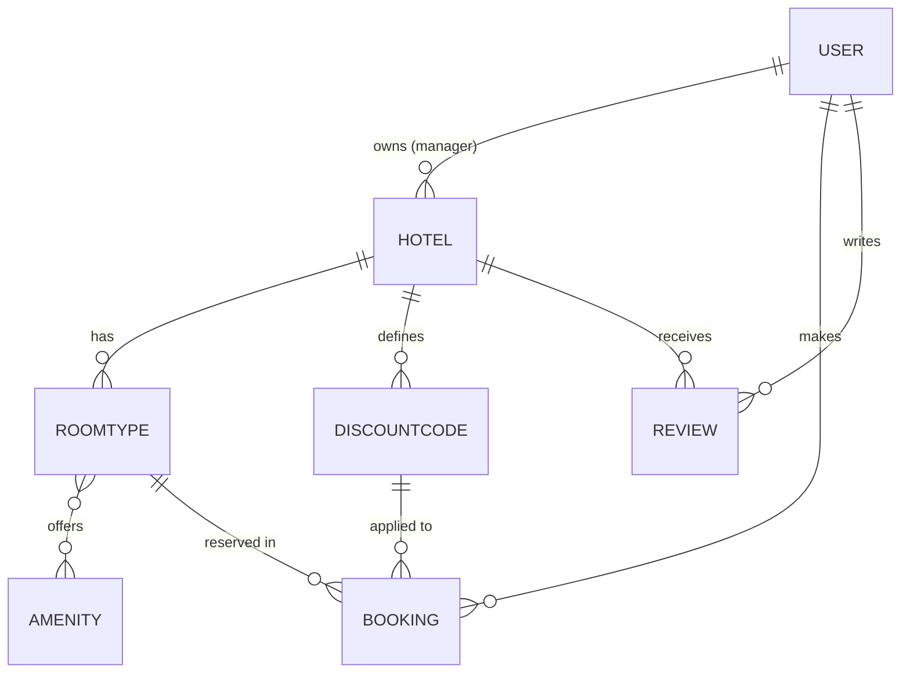

# DATA MODEL (draft v0 — finalised in P1-08; changes via /pair-contract)

## accounts.User (extends AbstractUser)
| Field | Type | Notes |
|---|---|---|
| role | CharField choices `manager` / `guest` | default `guest` |
| phone | CharField(20), blank | |
| email | unique, required | login by email or username (decide in P2-02) |
| email_verified | BooleanField default False | P4-01 |

## hotels.Hotel
owner FK User (role manager, CASCADE, related `hotels`) · name · city (indexed) · address · description · star_rating (1–5, nullable) ·
latitude/longitude (Decimal, nullable; bonus map) · image_url (optional) · is_active · created_at.

## hotels.Amenity
name (unique) — e.g. wifi, breakfast, parking, pool.

## hotels.RoomType
hotel FK (CASCADE, related `room_types`) · title · description · capacity (PositiveSmallInteger ≥1) ·
price_per_night (PositiveBigInteger, Toman) · quantity (PositiveInteger ≥1) · amenities M2M Amenity · created_at.
Constraint: unique (hotel, title).

## bookings.DiscountCode
hotel FK (CASCADE) · code (unique per hotel, uppercase) · percent (1–100, CheckConstraint) · valid_from · valid_to ·
max_uses (nullable = unlimited) · used_count (default 0) · is_active.

## bookings.Booking
guest FK User (PROTECT, related `bookings`) · room_type FK RoomType (PROTECT, related `bookings`) · check_in · check_out ·
rooms_count (≥1) · guests_count (≥1) · nights (derived, stored) · price_per_night_snapshot · subtotal · discount_code FK null (SET_NULL) ·
discount_amount · total_price · status (`confirmed` / `cancelled`) · created_at · cancelled_at null.
Constraints: `check_out > check_in`. Indexes: (room_type, check_in, check_out), (guest, status).

## reviews.Review (bonus)
hotel FK · user FK · rating 1–5 · comment · created_at. Unique (hotel, user).

## Business rules
- Capacity: `guests_count <= room_type.capacity * rooms_count`.
- Availability: see DECISIONS D-006. Cancelled bookings free the rooms.
- Discount valid if: active, `valid_from <= today <= valid_to`, `used_count < max_uses` (if set), belongs to the SAME hotel as the room type.
  `used_count` increments on booking creation, decrements on cancellation (within same transaction).
- Manager sees/edits only own hotels, room types, discounts and bookings of own hotels.
- Guest can cancel own booking only if `check_in > today` and status is `confirmed`.
