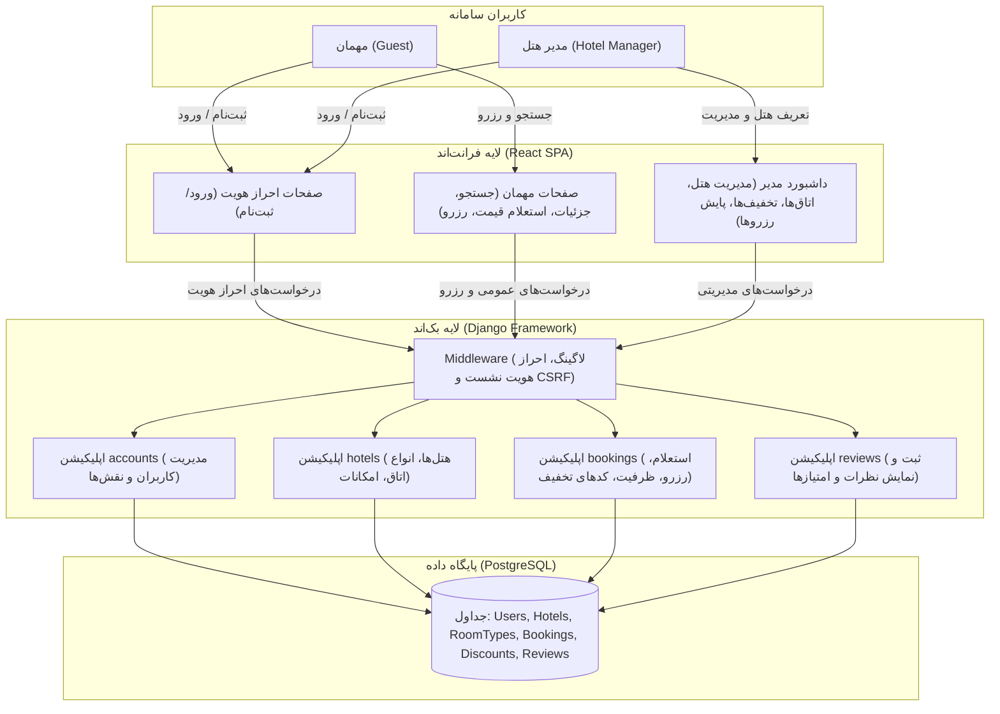
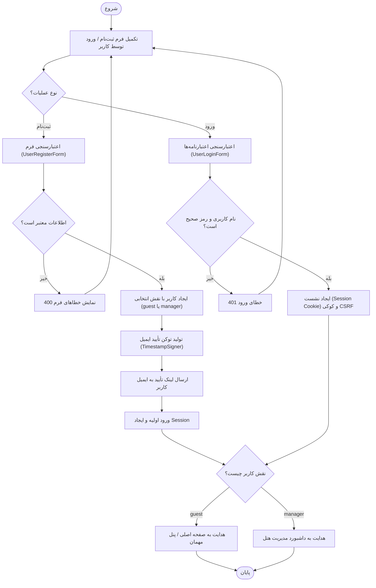
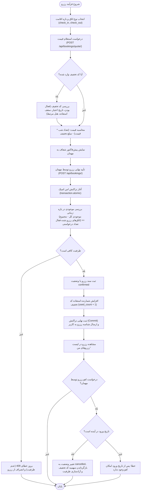
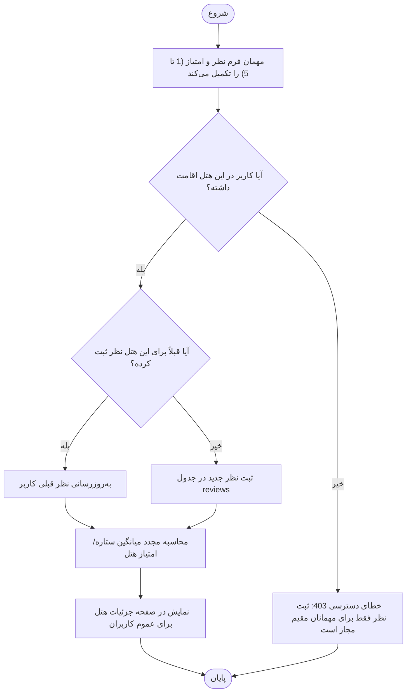
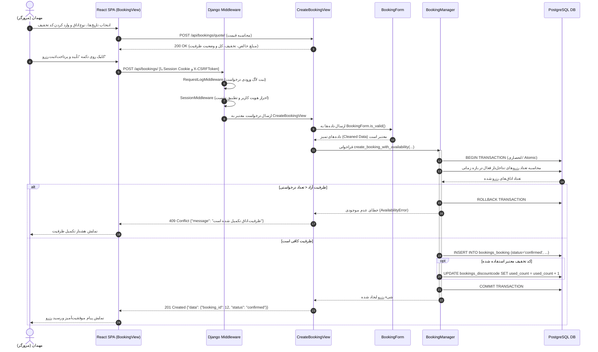

# PROCESS DIAGRAMS (دیاگرام‌های فرآیندی سیستم رزرواسیون هتل)

این مستند شامل دیاگرام‌های جریان کلی سیستم، دیاگرام‌های جریان به تفکیک ماژول‌ها (اپلیکیشن‌های جنگو) و دیاگرام‌های توالی (Sequence Diagrams) منطبق بر نیازمندی‌های پروژه و گزارش درسی است.

---

## ۱. دیاگرام جریان کلی سیستم (Overall System Flow)

نمودار زیر تعامل دو نقش اصلی سامانه (**مدیر هتل / Hotel Manager** و **مهمان / Guest**) با لایه کاربری (React SPA)، لایه منطق بک‌اند (Django Views/Forms/Managers) و پایگاه داده (PostgreSQL) را نشان می‌دهد.

### 📝 توضیحات جریان کلی:
- **چه اتفاقی می‌افتد**: کاربران از طریق رابط تک‌صفحه‌ای (React) درخواست‌های خود را ارسال می‌کنند. این درخواست‌ها از لایه‌های اعتبارسنجی میانی (لاگ سیستم، کوکی Session و بررسی CSRF) عبور کرده و به اپلیکیشن متناظر در جنگو می‌رسند. در بک‌اند، داده‌ها با Django Forms بررسی و سپس از طریق Managers و ORM جنگو در پایگاه داده PostgreSQL ذخیره یا بازیابی می‌شوند.
- **آغازگر**: مهمان یا مدیر هتل از طریق مرورگر.

---

## ۲. دیاگرام‌های جریان به تفکیک ماژول‌ها (Per-App Process Flows)

### ۲.۱. ماژول حساب‌های کاربری (`accounts`)

فرآیند ثبت‌نام، تخصیص نقش، تأیید ایمیل و ورود به سامانه:

#### 📝 توضیحات ماژول `accounts`:
- **چه اتفاقی می‌افتد**: کاربر مشخصات خود را شامل نام کاربری، ایمیل، کلمه عبور و نقش (مهمان یا مدیر) وارد می‌کند. سیستم پس از اعتبارسنجی، حساب کاربری را ذخیره کرده و توکن امن تأیید ایمیل را ایجاد می‌نماید. در ورود موفق، کوکی‌های Session و CSRF تنظیم شده و کاربر بر اساس نقش به مسیر مناسب هدایت می‌شود.
- **آغازگر**: کاربر جدید یا موجود در سامانه.

---

### ۲.۲. ماژول هتل‌ها و اتاق‌ها (`hotels`)

فرآیند تعریف هتل و اتاق توسط مدیر هتل، در کنار فرآیند جستجو و مشاهده توسط مهمان:

```mermaid
flowchart TD
    subgraph ManagerFlow["فرآیند مدیر هتل (Manager)"]
        M_Start([ورود مدیر]) --> M_HotelForm["ثبت مشخصات هتل (نام، شهر، آدرس، ستاره، تصویر)"]
        M_HotelForm --> M_SaveHotel["ذخیره هتل با مالکیت کاربر جاری (owner = request.user)"]
        M_SaveHotel --> M_RoomForm["تعریف انواع اتاق (RoomType: عنوان، ظرفیت، قیمت، تعداد موجودی، امکانات)"]
        M_RoomForm --> M_SaveRoom["ذخیره نوع اتاق و اتصال به هتل"]
    end

    subgraph GuestFlow["فرآیند مهمان (Guest & Public)"]
        G_Start([ورود به سامانه]) --> G_Search["ورود پارامترهای جستجو: شهر، تاریخ ورود/خروج، تعداد نفرات"]
        G_Search --> G_Filter["کوئری فیلتر هتل‌ها و بررسی دسترسی‌پذیری اولیه"]
        G_Filter --> G_List["نمایش لیست هتل‌های دارای ظرفیت همراه با حداقل قیمت"]
        G_List --> G_Detail["انتخاب هتل و مشاهده جزئیات + انواع اتاق و امکانات"]
    end
```

#### 📝 توضیحات ماژول `hotels`:
- **چه اتفاقی می‌افتد**: مدیر هتل می‌تواند هتل‌های خود و انواع اتاق‌های زیرمجموعه (با مشخصاتی چون ظرفیت، امکانات رفاهی، موجودی کل اتاق‌ها و قیمت هر شب) را تعریف و ویرایش کند. از سوی دیگر، کاربران می‌توانند بر اساس شهر، بازه زمانی و ظرفیت مورد نیاز به جستجوی هتل‌ها بپردازند و جزئیات هر هتل و امکانات اتاق‌ها را مشاهده نمایند.
- **آغازگر**: مدیر هتل برای ایجاد داده؛ مهمان برای جستجو و مشاهده.

---

### ۲.۳. ماژول رزروها و تخفیف‌ها (`bookings`)

فرآیند استعلام قیمت، اعتبارسنجی کد تخفیف، ثبت رزرو قطعی با بررسی همزمانی، و لغو رزرو:

#### 📝 توضیحات ماژول `bookings`:
- **چه اتفاقی می‌افتد**: مهمان ابتدا پیش‌فاکتور رزرو را مشاهده و در صورت تمایل کد تخفیف اعمال می‌کند. پس از تأیید نهایی، بک‌اند در قالب یک تراکنش اتمیک بررسی می‌کند که در تک‌تک شب‌های اقامت، اتاق آزاد کافی وجود داشته باشد. پس از ثبت موفق، وضعیت رزرو `confirmed` شده و کد تخفیف به‌روزرسانی می‌شود. در صورت لغو پیش از موعد، ظرفیت مجدداً آزاد می‌گردد.
- **آغازگر**: مهمان هتل.

---

### ۲.۴. ماژول نظرات و امتیازدهی (`reviews` - بخش امتیازی)

فرآیند ثبت نظر و امتیاز توسط مهمانان و نمایش در صفحه هتل:

#### 📝 توضیحات ماژول `reviews`:
- **چه اتفاقی می‌افتد**: تنها کاربرانی که اقامت تأیید شده در هتل داشته‌اند می‌توانند امتیاز و متن نظر خود را ثبت کنند. پس از ثبت، میانگین امتیاز هتل به‌روزرسانی شده و در صفحه عمومی هتل نمایش داده می‌شود.
- **آغازگر**: مهمان هتل پس از انجام اقامت.

---

## ۳. دیاگرام‌های توالی (Sequence Diagrams)

### ۳.۱. دیاگرام توالی: فرآیند رزرو اتاق توسط مهمان (Guest Books a Room)

این دیاگرام توالی دقیق ارسال درخواست، اعتبارسنجی‌ها، بررسی ظرفیت و ثبت نهایی در بک‌اند را به تصویر می‌کشد:

#### 📝 توضیحات توالی رزرو اتاق:
1. کاربر پس از انتخاب اتاق و بازه زمانی، پیش‌فاکتور را دریافت می‌کند.
2. با فشردن دکمه ثبت رزرو، فرانت‌اند ری‌اکت درخواست `POST` را با هدر `X-CSRFToken` و کوکی نشست کاربر به بک‌اند ارسال می‌کند.
3. میدل‌ور جنگو مشخصات درخواست را لاگ کرده و احراز هویت نشست را تأیید می‌کند.
4. فرم جنگو فیلدها و شروط پایه (بزرگتر بودن تاریخ خروج از ورود، تناسب نفرات با ظرفیت) را می‌سنجد.
5. لایه Manager در یک تراکنش امن پایگاه داده، ظرفیت باقی‌مانده را استعلام می‌کند. اگر رزروهای همپوشان مانع ظرفیت شوند تراکنش بازگردانده شده و خطای `409 Conflict` بازمی‌گردد؛ در غیر این صورت، سند رزرو صادر و تراکنش کامیت می‌شود.

---

### ۳.۲. دیاگرام توالی: مشاهده وضعیت و اتاق‌های آزاد/رزرو شده توسط مدیر (Manager Views Booked & Free Rooms)

این دیاگرام نحوه استعلام و آماده‌سازی ماتریس تقویمی اتاق‌ها را توسط مدیر هتل نمایش می‌دهد:

#### 📝 توضیحات توالی مشاهده دسترسی‌پذیری توسط مدیر:
1. مدیر هتل با تعیین شناسه هتل و بازه تاریخی مورد نظر خود، درخواست دریافت تقویم وضعیت اتاق‌ها را ثبت می‌کند.
2. سیستم بررسی می‌کند که آیا کاربر جاری مالک هتل انتخابی است یا خیر (جلوگیری از دسترسی مدیران دیگر به داده‌های هتل رقیب).
3. منطق کوئری بک‌اند، انواع اتاق‌ها و رزروهای فعال بازه زمانی را از دیتابیس واکشی کرده و به ازای هر روز اقامت، تعداد کل موجودی، تعداد رزرو شده و تعداد اتاق‌های آزاد را به دقت تجمیع می‌کند.
4. فرانت‌اند این ساختار ماتریسی را به شکل تقویم یا جدولی شفاف و رنگی (نشانگر روزهای پر و خالی) به مدیر نمایش می‌دهد.
