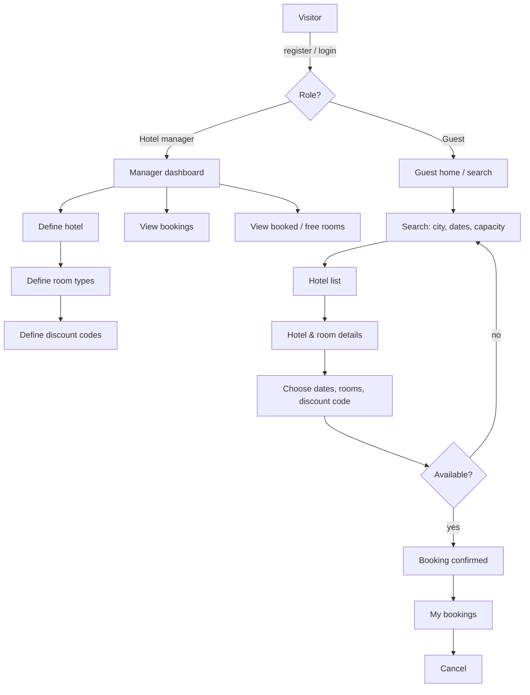

# PROCESS DIAGRAMS (filled in P1-02 — Mermaid; export PNG/SVG for the final report)

Required by the course: overall process diagram + explanation per web app. Start from these skeletons.

## Overall

TODO(P1-02, owner B): per-app diagrams — accounts (register/login/verify), hotels (manager CRUD, public search),
bookings (availability check, discount, create, cancel), reviews (bonus); plus a sequence diagram of "guest books a room".
