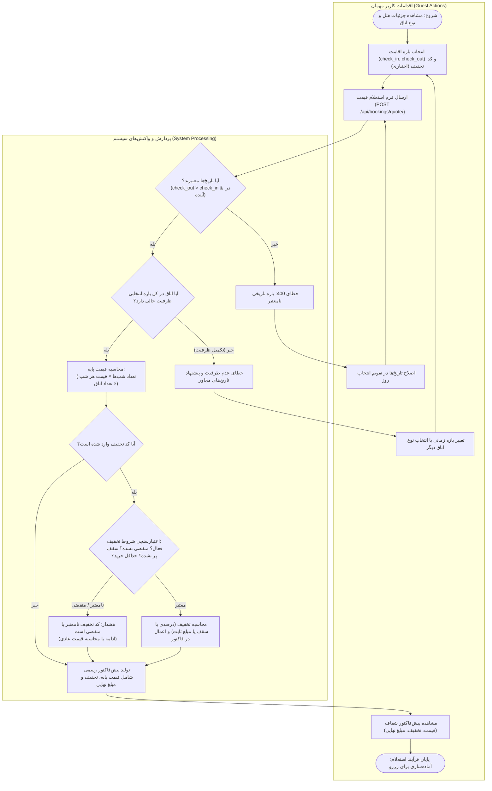
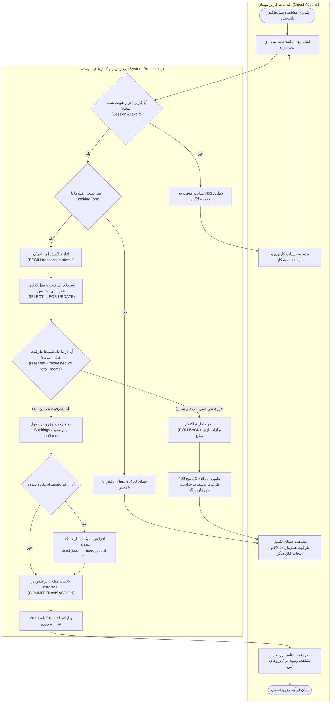
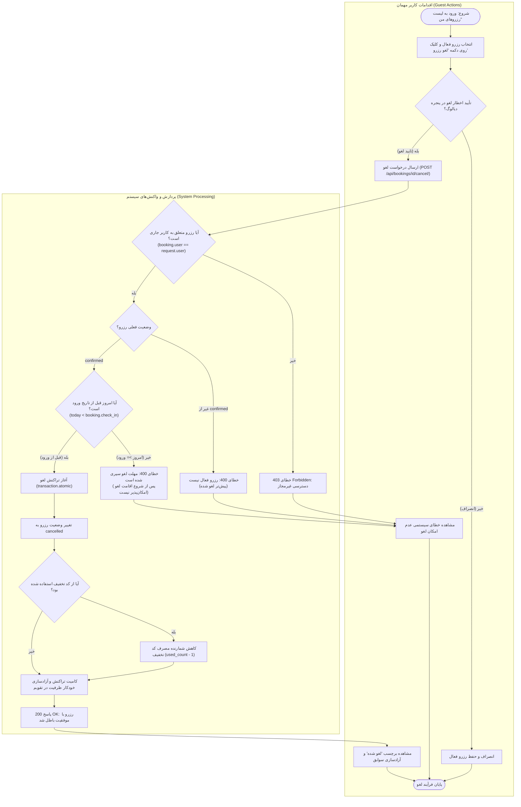
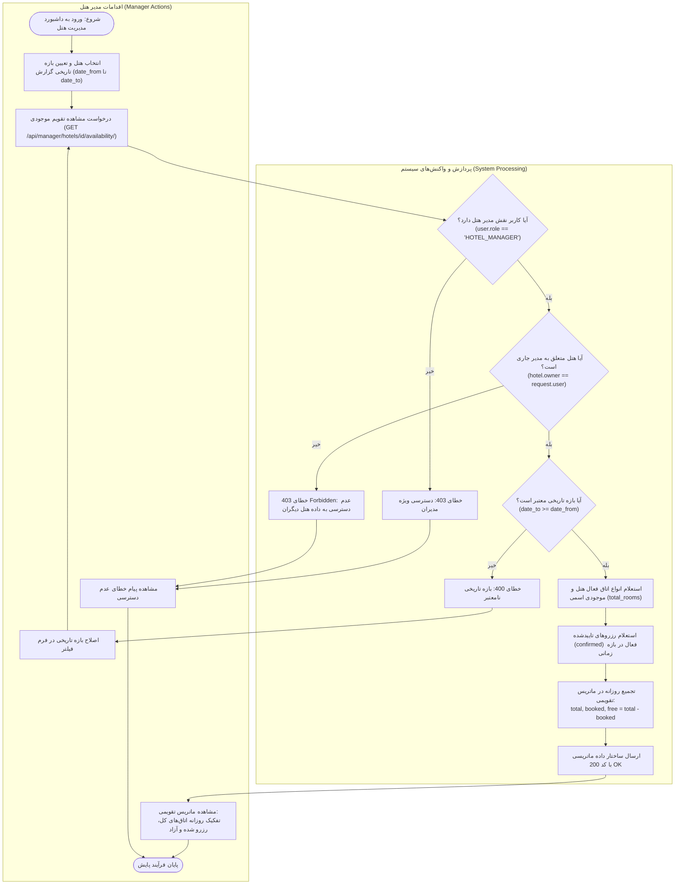
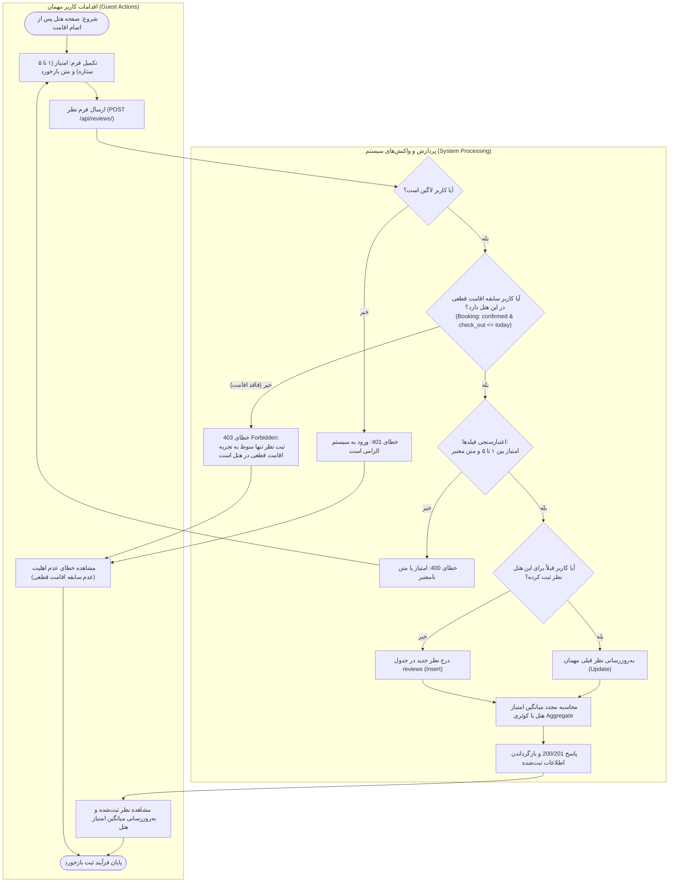
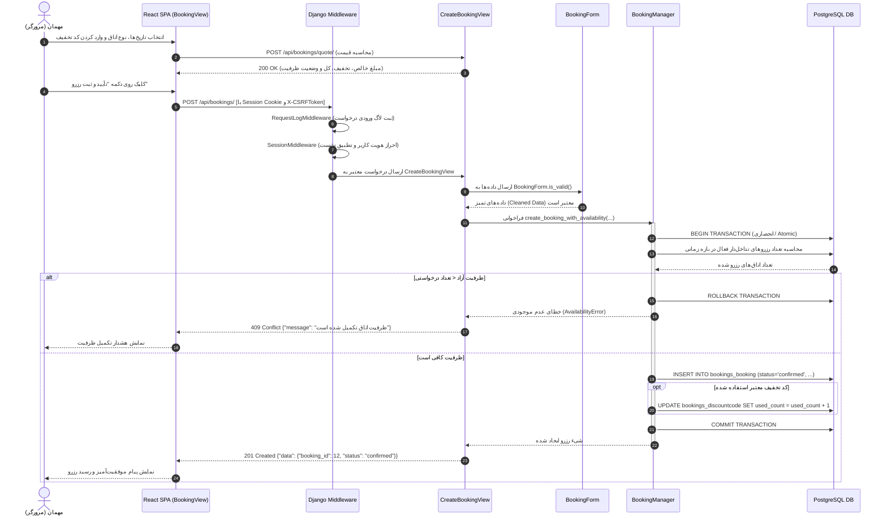
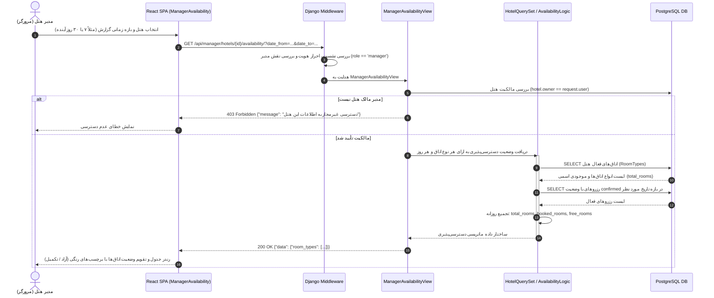

# مستند فرآیندهای اصلی سامانه رزرواسیون هتل (Business Process Diagrams)

این مستند شامل نمودارهای فرآیندی مستقل برای **فرآیندهای اصلی کسب‌وکار (Main Business Processes)** سامانه رزرواسیون هتل است که منطبق بر شیوه‌نامه ارزیابی درس برنامه‌نویسی وب طراحی شده‌اند.

> **نکات طراحی طبق شیوه‌نامه استاد:**
> ۱. فرآیندهای روتین (نظیر ثبت‌نام/ورود، CRUD ساده و فیلترهای پایه‌ای) حذف شده و تمرکز بر منطق تجاری اصلی سیستم است.
> ۲. از رسم نمودار بسیار بزرگ و یکپارچه خودداری شده و هر فرآیند در نموداری مستقل از نقطه شروع تا پایان با ساختار خطوط شناوری (Swimlane/Subgraph) ترسیم شده است.
> ۳. در تمام نمودارها، **اقدامات کاربر (مهمان/مدیر)** و **واکنش‌ها و پردازش سیستم (فرانت‌اند/بک‌اند/دیتابیس)** در دو ستون جداگانه تفکیک شده‌اند.
> ۴. نقاط تصمیم‌گیری (Decision Points)، شرایط خطا (۴۰۰، ۴۰۱، ۴۰۳، ۴۰۹)، مسیرهای جایگزین و بازگشت منابع به طور کامل مدل شده‌اند.

---

## فهرست فرآیندهای اصلی:
1. [فرآیند ۱: استعلام موجودی، محاسبه قیمت پویا و اعتبارسنجی کد تخفیف](#۱-فرآیند-استعلام-موجودی-محاسبه-قیمت-پویا-و-اعتبارسنجی-کد-تخفیف)
2. [فرآیند ۲: ثبت قطعی رزرو اتاق با کنترل همزمانی و تراکنش اتمیک (جلوگیری از Overbooking)](#۲-فرآیند-ثبت-قطعی-رزرو-اتاق-با-کنترل-همزمانی-و-تراکنش-اتمیک)
3. [فرآیند ۳: لغو رزرو، اعتبارسنجی بازه زمانی، آزادسازی ظرفیت و بازگشت سهمیه تخفیف](#۳-فرآیند-لغو-رزرو-اعتبارسنجی-بازه-زمانی-آزادسازی-ظرفیت-و-بازگشت-سهمیه)
4. [فرآیند ۴: پایش ماتریس ظرفیت و تقویم وضعیت اتاق‌های پر و خالی توسط مدیر هتل](#۴-فرآیند-پایش-ماتریس-ظرفیت-و-تقویم-وضعیت-اتاقهای-پر-و-خالی)
5. [فرآیند ۵ (امتیازی): ثبت و اعتبارسنجی نظر مهمان بر اساس سابقه اقامت قطعی](#۵-فرآیند-امتیازی-ثبت-و-اعتبارسنجی-نظر-مهمان-بر-اساس-سابقه-اقامت-قطعی)
6. [ضمیمه فنی: دیاگرام‌های توالی (Sequence Diagrams)](#ضمیمه-فنی-دیاگرامهای-توالی-sequence-diagrams)

---

## ۱. فرآیند استعلام موجودی، محاسبه قیمت پویا و اعتبارسنجی کد تخفیف
**Guest Room Quote, Capacity Pre-check & Discount Validation**

### مشخصات فرآیند:
- **هدف (Goal):** محاسبه بلادرنگ و شفاف پیش‌فاکتور اقامت برای مهمان با بررسی اولیه دسترسی‌پذیری اتاق و ارزیابی شروط چندگانه کد تخفیف پیش از تعهد رزرو.
- **نقش‌های درگیر (Actors):** کاربر مهمان (Guest)، سیستم (کلاینت React، اندپوینت استعلام جنگو، پایگاه داده PostgreSQL).
- **پیش‌شرط‌ها (Pre-conditions):**
  1. هتل و نوع اتاق (`RoomType`) فعال در پایگاه‌داده وجود داشته باشد.
  2. مهمان صفحه جزئیات اتاق را باز کرده باشد.
- **گام‌های اصلی (Main Flow):**
  1. مهمان بازه تاریخی ورود و خروج (`check_in`, `check_out`)، تعداد اتاق درخواستی و در صورت تمایل کد تخفیف را وارد می‌کند.
  2. کلاینت درخواست `POST /api/bookings/quote/` را به سرور ارسال می‌نماید.
  3. سیستم معتبر بودن تاریخ‌ها (تاریخ خروج بعد از ورود و عدم انتخاب تاریخ در گذشته) را بررسی می‌کند.
  4. سیستم موجودی اسمی اتاق را در برابر رزروهای قطعی جاری در آن بازه زمانی می‌سنجد.
  5. در صورت کافی بودن ظرفیت، قیمت پایه به فرمول `تعداد شب‌ها × قیمت هر شب × تعداد اتاق` محاسبه می‌شود.
  6. در صورت ارسال کد تخفیف، سیستم شرایط اعتبار را ارزیابی می‌کند:
     - فعال بودن کد (`is_active`)
     - معتبر بودن تاریخ انقضا (`valid_from <= today <= valid_to`)
     - پر نشدن سقف مجاز استفاده (`used_count < max_uses`)
     - رسیدن به حداقل مبلغ فاکتور (`subtotal >= min_booking_amount`)
     - اختصاصی نبودن کد برای هتل دیگر
  7. در صورت انطباق، مبلغ تخفیف محاسبه و از فاکتور کسر می‌شود؛ در غیر این صورت هشدار عدم تطابق تخفیف داده شده اما پیش‌فاکتور پایه تولید می‌گردد.
  8. پیش‌فاکتور نهایی با تفکیک قیمت پایه، سود مهمان از تخفیف و مبلغ نهایی قابل پرداخت رندر می‌شود.
- **جریان‌های استثنا و خطا (Alternative & Error Flows):**
  - **خطای تاریخ نامعتبر:** در صورت `check_out <= check_in`، خطای 400 برگردانده شده و مهمان به اصلاح تقویم هدایت می‌شود.
  - **خطای نبود ظرفیت در بازه:** در صورت تکمیل ظرفیت اتاق‌ها در حتی یک شب از بازه، پیام تکمیل ظرفیت بازگردانده شده و تقویم روزهای آزاد پیشنهاد می‌گردد.
  - **کد تخفیف نامعتبر/منقضی:** سیستم فرآیند را لغو نمی‌کند؛ بلکه با صدور هشدار، قیمت عادی بدون تخفیف را محاسبه می‌نماید تا کاربر سردرگم نشود.
- **پس‌شرط‌ها (Post-conditions):**
  - پیش‌فاکتور معتبر تولید شده و مهمان دکمه فعال «تأیید و ثبت نهایی رزرو» را در اختیار دارد.

---

## ۲. فرآیند ثبت قطعی رزرو اتاق با کنترل همزمانی و تراکنش اتمیک
**Booking Creation & Concurrency Control Process (Overbooking Prevention)**

### مشخصات فرآیند:
- **هدف (Goal):** ثبت امن و بدون خطای رزرو با مکانیزم همزمانی پایگاه‌داده به گونه‌ای که در صورت ثبت همزمان آخرین اتاق توسط دو کاربر، فقط یکی موفق شود و از پدیده Overbooking به طور کامل جلوگیری گردد.
- **نقش‌های درگیر (Actors):** کاربر مهمان (Guest)، سیستم (ویو جنگو، BookingForm، BookingManager با تراکنش PostgreSQL).
- **پیش‌شرط‌ها (Pre-conditions):**
  1. مهمان در سیستم لاگین کرده باشد (`request.user.is_authenticated`).
  2. پیش‌فاکتور با پارامترهای مشخص اقامت تأیید شده باشد.
- **گام‌های اصلی (Main Flow):**
  1. مهمان با فشردن دکمه «تأیید نهایی و ثبت رزرو»، درخواست `POST /api/bookings/` را همراه با CSRF توکن ارسال می‌کند.
  2. سیستم وضعیت نشست (Session) را احراز می‌کند.
  3. فرم `BookingForm` صحت ساختار ورودی‌ها را اعتبارسنجی می‌نماید.
  4. لایه بیزینس یک تراکنش اتمیک پایگاه‌داده (`transaction.atomic`) باز می‌کند.
  5. رکوردهای رزرو همپوشان و ظرفیت نوع اتاق در بازه اقامت در سطح دیتابیس قفل و مجدداً محاسبه می‌شوند.
  6. شرط ظرفیت قطعی بررسی می‌شود: `active_bookings + requested_rooms <= total_rooms`.
  7. در صورت تایید ظرفیت، سند رزرو با وضعیت `confirmed` و شناسه یکتا درج می‌گردد.
  8. در صورت استفاده از تخفیف، فیلد `used_count` کد تخفیف اتمیک یک واحد افزایش می‌یابد.
  9. تراکنش کامیت (Commit) شده، ظرفیت کسر می‌گردد و رسید رزرو با وضعیت 201 Created به مهمان تحویل می‌شود.
- **جریان‌های استثنا و خطا (Alternative & Error Flows):**
  - **کاربر لاگین نباشد:** پاسخ خطای 401 Unauthorized و هدایت به صفحه ورود با حفظ داده‌های رزرو.
  - **نقض همزمانی / تکمیل ظرفیت در آخرین لحظه:** اگر کاربر دیگری چند میلی‌ثانیه قبل اتاق آخر را گرفته باشد، بررسی ظرفیت ناموفق شده، تراکنش سریعاً Rollback می‌شود و خطای `409 Conflict` (تکمیل ظرفیت همزمان) صادر می‌گردد.
  - **خطای اعتبارسنجی فرم:** پاسخ 400 Bad Request همراه با ذکر فیلدهای مشکل‌دار.
- **پس‌شرط‌ها (Post-conditions):**
  - رکورد رزرو پایدار در دیتابیس ثبت شده، ظرفیت اتاق برای سایرین کاهش یافته و رسید رزرو در داشبورد مهمان ذخیره است.

---

## ۳. فرآیند لغو رزرو، اعتبارسنجی بازه زمانی، آزادسازی ظرفیت و بازگشت سهمیه
**Booking Cancellation & Resource Rollback Process**

### مشخصات فرآیند:
- **هدف (Goal):** چرخه عمر ابطال رزرو توسط مهمان، تضمین رعایت قوانین زمانی کنسلی (قبل از شروع سفر)، تغییر وضعیت به CANCELLED، بازگرداندن سهمیه کد تخفیف و بازگرداندن فوری ظرفیت به هتل.
- **نقش‌های درگیر (Actors):** کاربر مهمان (Guest)، سیستم (ویو لغو رزرو، اعتبارسنجی وضعیت، تراکنش PostgreSQL).
- **پیش‌شرط‌ها (Pre-conditions):**
  1. مهمان وارد حساب کاربری خود شده باشد.
  2. رزرو با وضعیت `confirmed` در حساب مهمان موجود باشد.
- **گام‌های اصلی (Main Flow):**
  1. مهمان وارد بخش «رزروهای من» شده و دکمه «لغو رزرو» را فشرده و پیام هشدار را تایید می‌کند.
  2. درخواست `POST /api/bookings/{id}/cancel/` به بک‌اند ارسال می‌شود.
  3. سیستم مالکیت رزرو را ارزیابی می‌کند (`booking.user == request.user`).
  4. سیستم وضعیت فعلی رزرو را بررسی می‌کند (`status == 'confirmed'`).
  5. سیستم شرط تاریخ را می‌سنجد: آیا تاریخ جاری قبل از تاریخ ورود است (`today < booking.check_in`)؟
  6. تراکنش پایگاه‌داده آغاز شده و وضعیت رزرو به `cancelled` تغییر می‌یابد.
  7. در صورت استفاده از کد تخفیف، شمارنده `used_count` کاهش یافته و سهمیه بازمی‌گردد.
  8. با خروج رکورد از دایره رزروهای معتبر، ظرفیت اتاق بلافاصله در ماتریس تقویم آزاد می‌شود.
  9. تراکنش کامیت شده و پیام تایید ابطال با وضعیت 200 OK نمایش می‌یابد.
- **جریان‌های استثنا و خطا (Alternative & Error Flows):**
  - **عدم انطباق مالکیت:** خطای 403 Forbidden در صورت تلاش برای لغو رزرو شخص دیگر.
  - **سپری شدن مهلت لغو:** در صورت اقدام در تاریخ ورود یا پس از آن (`today >= check_in`)، خطای 400 Bad Request صادر شده و لغو رد می‌شود.
  - **رزرو قبلاً لغو شده:** در صورت وضعیت نامعتبر، پیام خطای مناسب داده می‌شود.
- **پس‌شرط‌ها (Post-conditions):**
  - رزرو به عنوان باطله در سوابق حفظ شده، اتاق‌ها به چرخه رزرواسیون هتل بازمی‌گردند.

---

## ۴. فرآیند پایش ماتریس ظرفیت و تقویم وضعیت اتاق‌های پر و خالی
**Manager Room Availability Matrix & Occupancy Monitoring Process**

### مشخصات فرآیند:
- **هدف (Goal):** پایش متمرکز وضعیت اشغال هتل توسط هتلدار در قالب تقویم روزانه با محاسبه دقیق تعداد کل، پر و آزاد به ازای هر نوع اتاق.
- **نقش‌های درگیر (Actors):** مدیر هتل (Hotel Manager)، سیستم (ویو مدیریتی، گارد نقش، کوئری‌های تجمیعی پایگاه داده).
- **پیش‌شرط‌ها (Pre-conditions):**
  1. کاربر با نقش مدیر هتل (`HOTEL_MANAGER`) وارد سیستم شده باشد.
  2. هتل انتخابی متعلق به این مدیر باشد (`hotel.owner == request.user`).
- **گام‌های اصلی (Main Flow):**
  1. مدیر هتل از داشبورد مدیریتی، هتل مورد نظر و بازه تاریخی گزارش (مثلاً ۳۰ روز آینده) را انتخاب می‌کند.
  2. درخواست `GET /api/manager/hotels/{id}/availability/?date_from=...&date_to=...` ارسال می‌شود.
  3. سیستم نقش کاربر جاری را بررسی می‌کند.
  4. سیستم مالکیت مدیر بر هتل را تطبیق می‌دهد.
  5. بازه تاریخی اعتبارسنجی می‌شود (`date_to >= date_from`).
  6. سیستم کوئری تجمیعی را اجرا می‌کند:
     - استخراج انواع اتاق‌های فعال (`RoomTypes`) با موجودی کل هر کدام.
     - استخراج تمامی رزروهای تأییدشده (`confirmed`) فعال در آن بازه زمانی.
  7. سیستم ماتریس تقویمی را به ازای تک‌تک روزها محاسبه می‌کند:
     - `total_rooms` = ظرفیت اسمی اتاق
     - `booked_rooms` = مجموع اتاق‌های رزرو شده در آن تاریخ
     - `free_rooms` = `total_rooms - booked_rooms`
  8. ساختار داده تقویمی با وضعیت 200 OK ارسال شده و در فرانت‌اند به شکل جدول و تقویم رنگی (سبز: ظرفیت آزاد، قرمز: پر، نارنجی: رو به اتمام) به نمایش درمی‌آید.
- **جریان‌های استثنا و خطا (Alternative & Error Flows):**
  - **نقش نامعتبر:** در صورت کاربر غیرمدیر، خطای 403 صادر می‌شود.
  - **هتل غیر:** در صورت تلاش برای دسترسی به هتل سایر مدیران، خطای 403 یا 404 برگردانده می‌شود.
  - **بازه تاریخی نامعتبر:** در صورت `date_to < date_from`، خطای 400 Bad Request ارسال می‌گردد.
- **پس‌شرط‌ها (Post-conditions):**
  - ماتریس ظرفیت در اختیار هتلدار قرار گرفته و مبنای تصمیم‌گیری برای قیمت‌گذاری یا تعریف تخفیف می‌گردد.

---

## ۵. فرآیند (امتیازی): ثبت و اعتبارسنجی نظر مهمان بر اساس سابقه اقامت قطعی
**Verified Stay Review & Rating Calculation Process**

### مشخصات فرآیند:
- **هدف (Goal):** جلوگیری از نظرات فیک و ارتقای اعتبار سامانه از طریق محدودسازی ثبت امتیاز و بازخورد تنها به مهمانانی که اقامت قطعی در هتل داشته و سفرشان به پایان رسیده است.
- **نقش‌های درگیر (Actors):** کاربر مهمان (Guest)، سیستم (ویو نظرات، ReviewForm، پایگاه داده PostgreSQL).
- **پیش‌شرط‌ها (Pre-conditions):**
  1. مهمان لاگین کرده باشد.
  2. کاربر دارای حداقل یک رزرو تأییدشده با تاریخ خروج در گذشته باشد (`Booking: status='confirmed' & check_out <= today`).
- **گام‌های اصلی (Main Flow):**
  1. مهمان فرم نظر و رتبه‌بندی (۱ تا ۵ ستاره) را پر کرده و ارسال می‌کند (`POST /api/reviews/`).
  2. سیستم سابقه اقامت مهمان در این هتل را در دیتابیس استعلام می‌کند.
  3. اعتبارسنجی فیلدها با `ReviewForm` صورت می‌گیرد.
  4. سیستم بررسی می‌کند آیا مهمان قبلاً برای این هتل نظری ثبت کرده است؟
  5. در صورت ثبت قبلی، نظر به‌روزرسانی (Update) شده و در غیر این صورت نظر جدید درج (Insert) می‌گردد (قاعده یک نظر به ازای هر مهمان در هر هتل).
  6. میانگین رتبه ستاره‌های هتل با دستور Aggregate در دیتابیس مجدداً محاسبه و به‌روزرسانی می‌شود.
  7. نظر ثبت‌شده همراه با میانگین جدید هتل برای عموم به نمایش درمی‌آید.
- **جریان‌های استثنا و خطا (Alternative & Error Flows):**
  - **عدم سابقه اقامت:** خطای 403 Forbidden با پیام «تنها مهمانانی که در این هتل اقامت داشته‌اند مجاز به ثبت نظر هستند».
  - **امتیاز نامعتبر:** خطای 400 Bad Request در صورت ثبت امتیاز خارج از ۱ تا ۵.
- **پس‌شرط‌ها (Post-conditions):**
  - نظر معتبر ثبت شده و میانگین رضایت هتل بر اساس بازخورد واقعی تغییر یافته است.

---

## ضمیمه فنی: دیاگرام‌های توالی (Sequence Diagrams)

### ۱. دیاگرام توالی: فرآیند ثبت رزرو اتاق توسط مهمان

### ۲. دیاگرام توالی: مشاهده ماتریس اتاق‌های آزاد/رزرو شده توسط مدیر

