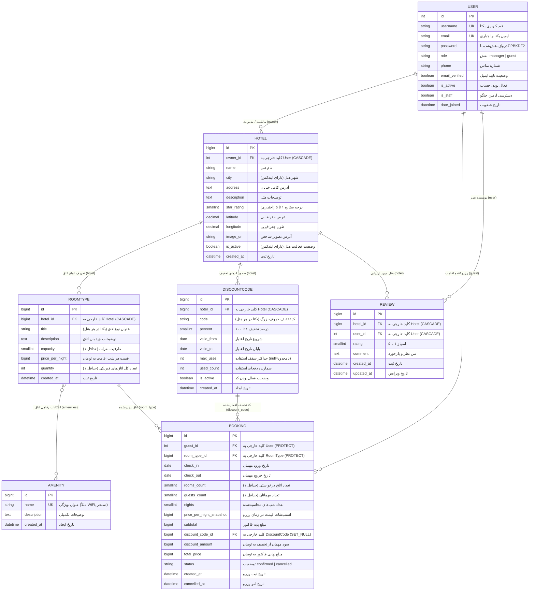

# بخش سوم گزارش نهایی: مدل‌های داده و روابط (Models & Database Schema)

این بخش به تشریح کامل پایگاه داده، نمودار رابطه موجودیت‌ها (ERD)، جدول مشخصات فیلدها، تحلیل روابط کلید خارجی، دلایل انتخاب سیاست‌های حذف آبشاری (`on_delete`)، قیود جامعیت داده‌ها (`CheckConstraint` و `UniqueConstraint`) و ایندکس‌های بهینه‌سازی در پایگاه داده PostgreSQL می‌پردازد.

---

## ۱. نمودار رابطه موجودیت‌ها (Entity-Relationship Diagram - ERD)

---

## ۲. تحلیل روابط و دلایل انتخاب سیاست‌های `on_delete`

انتخاب رفتار کلید خارجی (`on_delete`) در زمان حذف رکوردهای والد یکی از مباحث اساسی طراحی پایگاه داده است که در این پروژه با دقت مهندسی بالا انتخاب شده است:

| رابطه (Relationship) | مدل مبدا → مقصد | سیاست `on_delete` | دلیل فنی و پیامد تجاری |
|---|---|:---:|---|
| **هتل به مدیر هتل** | `Hotel.owner → User` | `CASCADE` | هتل یک دارایی تحت تملک مدیر است. در صورت حذف حساب کاربری مدیر، تمامی هتل‌ها و اطلاعات تابعه او باید به صورت آبشاری حذف شوند. |
| **نوع اتاق به هتل** | `RoomType.hotel → Hotel` | `CASCADE` | اتاق بدون وجود هتل فیزیکی مفهوم تجاری ندارد؛ بنابراین با حذف هتل، انواع اتاق‌های تابعه آن نیز حذف می‌گردند. |
| **کد تخفیف به هتل** | `DiscountCode.hotel → Hotel` | `CASCADE` | کدهای تخفیف به صورت اختصاصی برای یک هتل صادر می‌شوند؛ با حذف هتل، کوپن‌های آن نیز بی‌معنی شده و حذف می‌شوند. |
| **نظر به هتل / کاربر** | `Review.hotel / user` | `CASCADE` | در صورت حذف هتل یا حذف کاربر، نظرات و امتیازات وابسته به آن حذف می‌شوند. |
| **رزرو به مهمان** | `Booking.guest → User` | **`PROTECT`** | **حفظ اسناد مالی:** اگر مهمانی سابقه رزرو در سیستم داشته باشد، حساب کاربری او نباید به سادگی حذف شود تا تاریخچه تراکنش‌های مالی و تعهدات رزرو هتل از بین نرود. جنگو در صورت تلاش برای حذف کاربر با رزرو فعال، خطای `ProtectedError` صادر می‌کند. |
| **رزرو به نوع اتاق** | `Booking.room_type → RoomType` | **`PROTECT`** | **حفظ اسناد رزرو و ظرفیت:** مدیری نمی‌تواند نوع اتاقی را که دارای رزروهای ثبت‌شده در سیستم است حذف کند؛ زیرا باعث از بین رفتن تعهد هتل به مهمان و شکست ارجاعات مالی فاکتور می‌شود. |
| **رزرو به کد تخفیف** | `Booking.discount_code → DiscountCode` | **`SET_NULL`** | اگر مدیر هتل یک کد تخفیف منقضی‌شده را از سیستم حذف کند، فاکتورهای رزرو قبلی که از آن کد استفاده کرده بودند نباید حذف شوند؛ بلکه شناسه کوپن در رزرو برابر `NULL` می‌شود، در حالی که مقادیر مالی `discount_amount` و `total_price` قبلاً در فیلدهای اسنپ‌شات تثبیت شده‌اند و تغییر نمی‌کنند. |

---

## ۳. تحلیل تفصیلی مشخصات هر مدل

### ۳.۱. مدل کاربر (`apps.accounts.models.User`)
- **هدف:** مدل احراز هویت سفارشی و متمرکز که از `AbstractUser` جنگو ارث‌بری می‌کند و به تفکیک نقش‌های مهمان و مدیر می‌پردازد.
- **مدیر سفارشی (`UserManager`):** تضمین مقداردهی پیش‌فرض نقش مهمان (`guest`)، اعتبارسنجی اجباری بودن فیلد ایمیل، و ارائه متدهای کمکی `User.objects.managers()` و `User.objects.guests()`.

| فیلد | نوع داده در جنگو | نوع داده در PostgreSQL | اختیاری؟ | مقادیر پیش‌فرض / توضیحات |
|---|---|---|:---:|---|
| `id` | `AutoField` | `serial PRIMARY KEY` | خیر | شناسه خودکار افزایشی |
| `username` | `CharField(150)` | `varchar(150) UNIQUE` | خیر | نام کاربری یکتا |
| `email` | `EmailField(254)` | `varchar(254) UNIQUE` | خیر | ایمیل یکتا و اجباری جهت ارتباط و ورود |
| `password` | `CharField(128)` | `varchar(128)` | خیر | گذرواژه هش‌شده با الگوریتم امن PBKDF2 |
| `role` | `CharField(20)` | `varchar(20)` | خیر | نقش کاربر (`manager` یا `guest`؛ پیش‌فرض: `guest`) |
| `phone` | `CharField(20)` | `varchar(20)` | بله | شماره تماس تلفن همراه مهمان/مدیر |
| `email_verified` | `BooleanField` | `boolean` | خیر | وضعیت تایید ایمیل (پیش‌فرض: `False`) |
| `is_active` | `BooleanField` | `boolean` | خیر | وضعیت فعال بودن حساب (پیش‌فرض: `True`) |
| `date_joined` | `DateTimeField` | `timestamp with time zone` | خیر | زمان ایجاد حساب کاربری |

---

### ۳.۲. مدل ویژگی‌ها و امکانات رفاهی (`apps.hotels.models.Amenity`)
- **هدف:** تعریف ویژگی‌های استاندارد اتاق‌ها و هتل‌ها (مانند اینترنت پرسرعت، استخر، صبحانه، پارکینگ، بالکن).

| فیلد | نوع داده در جنگو | نوع داده در PostgreSQL | اختیاری؟ | توضیحات |
|---|---|---|:---:|---|
| `id` | `BigAutoField` | `bigserial PRIMARY KEY` | خیر | شناسه کلید اصلی |
| `name` | `CharField(100)` | `varchar(100) UNIQUE` | خیر | عنوان یکتای ویژگی |
| `description` | `TextField` | `text` | بله | توضیحات اختیاری |
| `created_at` | `DateTimeField` | `timestamp with time zone` | خیر | زمان ایجاد رکورد |

---

### ۳.۳. مدل هتل (`apps.hotels.models.Hotel`)
- **هدف:** معرفی واحد اقامتی تحت مدیریت یک مدیر هتل به همراه موقعیت مکانی و مشخصات ستاره.
- **مدیر سفارشی (`HotelQuerySet`):** فیلترهای بهینه `active()`، `in_city()`، `priced_between()`، و الحاق محاسبه کمترین قیمت هر شب با متد `with_min_price()`.

| فیلد | نوع داده در جنگو | نوع داده در PostgreSQL | اختیاری؟ | توضیحات |
|---|---|---|:---:|---|
| `id` | `BigAutoField` | `bigserial PRIMARY KEY` | خیر | شناسه کلید اصلی |
| `owner_id` | `ForeignKey(User)` | `integer REFERENCES accounts_user` | خیر | مالک هتل (`on_delete=CASCADE`) |
| `name` | `CharField(255)` | `varchar(255)` | خیر | نام هتل |
| `city` | `CharField(100)` | `varchar(100)` | خیر | شهر هتل (دارای ایندکس جهت جستجوی سریع) |
| `address` | `TextField` | `text` | خیر | آدرس کامل خیابان |
| `description` | `TextField` | `text` | بله | متن توضیحات و معرفی هتل |
| `star_rating` | `PositiveSmallIntegerField` | `smallint` | بله | درجه ستاره بین ۱ تا ۵ (دارای اعتبارسنجی) |
| `latitude` | `DecimalField(9, 6)` | `numeric(9,6)` | بله | عرض جغرافیایی |
| `longitude` | `DecimalField(9, 6)` | `numeric(9,6)` | بله | طول جغرافیایی |
| `image_url` | `URLField(500)` | `varchar(500)` | بله | پیوند تصویر شاخص هتل |
| `is_active` | `BooleanField` | `boolean` | خیر | وضعیت فعالیت در نتایج جستجو (پیش‌فرض: `True`) |
| `created_at` | `DateTimeField` | `timestamp with time zone` | خیر | تاریخ ثبت هتل |

#### ایندکس‌ها و قیود دیتابیسی مدل Hotel:
1. `hotel_city_idx`: ایندکس روی فیلد `city` برای پاسخ‌دهی بلادرنگ فیلتر شهر.
2. `hotel_is_active_idx`: ایندکس روی فیلد `is_active` جهت فیلتر سریع هتل‌های عمومی.
3. قید دامنه `hotel_star_rating_1_to_5`: قید `CHECK (star_rating BETWEEN 1 AND 5 OR star_rating IS NULL)`.

---

### ۳.۴. مدل نوع اتاق (`apps.hotels.models.RoomType`)
- **هدف:** دسته‌بندی اتاق‌های هتل با ظرفیت، قیمت هر شب و موجودی فیزیکی مستقل.
- **مدیر سفارشی (`RoomTypeQuerySet`):** ارائه متد حیاتی `with_availability(check_in, check_out)` که با یک زیرکوئری پایگاه داده، تعداد اتاق‌های آزاد را بدون افتادن در تله کوئری N+1 محاسبه می‌کند.

| فیلد | نوع داده در جنگو | نوع داده در PostgreSQL | اختیاری؟ | توضیحات |
|---|---|---|:---:|---|
| `id` | `BigAutoField` | `bigserial PRIMARY KEY` | خیر | شناسه کلید اصلی |
| `hotel_id` | `ForeignKey(Hotel)` | `bigint REFERENCES hotels_hotel` | خیر | هتل مربوطه (`on_delete=CASCADE`) |
| `title` | `CharField(150)` | `varchar(150)` | خیر | عنوان اتاق (مانند سوییت دونفره رویال) |
| `description` | `TextField` | `text` | بله | امکانات و چیدمان تخت‌ها |
| `capacity` | `PositiveSmallIntegerField`| `smallint` | خیر | حداکثر ظرفیت پذیرش نفرات (حداقل ۱) |
| `price_per_night` | `PositiveBigIntegerField` | `bigint` | خیر | بهای هر شب به تومان (پشتیبانی از اعداد بزرگ) |
| `quantity` | `PositiveIntegerField` | `integer` | خیر | تعداد کل اتاق‌های فیزیکی موجود از این نوع (حداقل ۱) |
| `amenities` | `ManyToManyField` | جدول واسط M2M | بله | امکانات اتاق متصل به `Amenity` |
| `created_at` | `DateTimeField` | `timestamp with time zone` | خیر | تاریخ تعریف نوع اتاق |

#### ایندکس‌ها و قیود دیتابیسی مدل RoomType:
1. قید یکتایی `unique_hotel_roomtype_title`: قید `UNIQUE (hotel_id, title)` مانع از ایجاد دو نوع اتاق با نام یکسان در یک هتل می‌شود.
2. قید جامعیت `roomtype_capacity_gte_1`: قید `CHECK (capacity >= 1)`.
3. قید جامعیت `roomtype_quantity_gte_1`: قید `CHECK (quantity >= 1)`.

---

### ۳.۵. مدل کد تخفیف (`apps.bookings.models.DiscountCode`)
- **هدف:** کدهای پروموشن و تخفیف درصدی تعریف‌شده توسط مدیر برای یک هتل مشخص.
- **مدیر سفارشی (`DiscountCodeManager`):** متد `valid_now(hotel, today)` برای ارزیابی تجاری وضعیت فعال بودن، بازه تاریخی و سقف مجاز استفاده.

| فیلد | نوع داده در جنگو | نوع داده در PostgreSQL | اختیاری؟ | توضیحات |
|---|---|---|:---:|---|
| `id` | `BigAutoField` | `bigserial PRIMARY KEY` | خیر | شناسه کلید اصلی |
| `hotel_id` | `ForeignKey(Hotel)` | `bigint REFERENCES hotels_hotel` | خیر | هتل صادرکننده کوپن (`CASCADE`) |
| `code` | `CharField(50)` | `varchar(50)` | خیر | کد تخفیف (ذخیره با حروف بزرگ انگلیسی) |
| `percent` | `PositiveSmallIntegerField`| `smallint` | خیر | درصد کسر تخفیف (بین ۱ تا ۱۰۰) |
| `valid_from` | `DateField` | `date` | خیر | شروع تاریخ مجاز استفاده (شامل) |
| `valid_to` | `DateField` | `date` | خیر | پایان تاریخ مجاز استفاده (شامل) |
| `max_uses` | `PositiveIntegerField` | `integer` | بله | سقف دفعات استفاده مجاز (`null` به معنی نامحدود) |
| `used_count` | `PositiveIntegerField` | `integer` | خیر | شمارنده تعداد مصرف‌شده (پیش‌فرض: ۰) |
| `is_active` | `BooleanField` | `boolean` | خیر | وضعیت فعال/غیرفعال دستی توسط مدیر |
| `created_at` | `DateTimeField` | `timestamp with time zone` | خیر | تاریخ ایجاد کد |

#### قیود دیتابیسی مدل DiscountCode:
1. قید یکتایی `unique_hotel_discount_code`: قید `UNIQUE (hotel_id, code)` جهت یکتایی کد در سطح هر هتل.
2. قید بازه درصد `discount_percent_1_to_100`: قید `CHECK (percent >= 1 AND percent <= 100)`.
3. قید تقدم تاریخ `discount_valid_to_gte_valid_from`: قید `CHECK (valid_to >= valid_from)`.
4. قید عدم منفی شدن شمارنده `discount_used_count_gte_0`: قید `CHECK (used_count >= 0)`.

---

### ۳.۶. مدل رزرو اقامت (`apps.bookings.models.Booking`)
- **هدف:** سند رزرو قطعی اقامت مهمان در هتل، نگهداری اسنپ‌شات‌های مالی، وضعیت سفارش و بازه‌های زمانی ورود/خروج.
- **مدیر سفارشی (`BookingQuerySet`):** متدهای دامنه `active()` (تنها رزروهای `confirmed`)، `overlapping(check_in, check_out)` و تفکیک دسترسی‌های مهمان و مدیر.

| فیلد | نوع داده در جنگو | نوع داده در PostgreSQL | اختیاری؟ | توضیحات |
|---|---|---|:---:|---|
| `id` | `BigAutoField` | `bigserial PRIMARY KEY` | خیر | شماره فاکتور و شناسه رزرو |
| `guest_id` | `ForeignKey(User)` | `integer REFERENCES accounts_user` | خیر | مهمان رزروکننده (`on_delete=PROTECT`) |
| `room_type_id` | `ForeignKey(RoomType)` | `bigint REFERENCES hotels_roomtype` | خیر | اتاق رزروشده (`on_delete=PROTECT`) |
| `check_in` | `DateField` | `date` | خیر | تاریخ ورود (ساعت ۱۴:۰۰) |
| `check_out` | `DateField` | `date` | خیر | تاریخ خروج (ساعت ۱۲:۰۰ ظهر، نامتقاطع) |
| `rooms_count` | `PositiveSmallIntegerField`| `smallint` | خیر | تعداد اتاق رزروشده (حداقل ۱) |
| `guests_count` | `PositiveSmallIntegerField`| `smallint` | خیر | تعداد مسافران مقیم (حداقل ۱) |
| `nights` | `PositiveSmallIntegerField`| `smallint` | خیر | مدت شب اقامت (`check_out - check_in`) |
| `price_per_night_snapshot` | `PositiveBigIntegerField` | `bigint` | خیر | تثبیت قیمت هر شب اتاق در لحظه ثبت رزرو |
| `subtotal` | `PositiveBigIntegerField` | `bigint` | خیر | جمع پایه قبل از تخفیف (`nights × price × rooms`) |
| `discount_code_id` | `ForeignKey(DiscountCode)`| `bigint REFERENCES ...` | بله | کوپن اعمال‌شده (`on_delete=SET_NULL`) |
| `discount_amount` | `PositiveBigIntegerField` | `bigint` | خیر | مبلغ ریالی تخفیف کسرشده به تومان |
| `total_price` | `PositiveBigIntegerField` | `bigint` | خیر | مبلغ نهایی پرداختی (`subtotal - discount_amount`) |
| `status` | `CharField(20)` | `varchar(20)` | خیر | وضعیت رزرو (`confirmed` یا `cancelled`) |
| `created_at` | `DateTimeField` | `timestamp with time zone` | خیر | زمان ایجاد و ثبت رزرو |
| `cancelled_at` | `DateTimeField` | `timestamp with time zone` | بله | زمان لغو رزرو توسط مهمان یا سیستم |

#### ایندکس‌ها و قیود دیتابیسی مدل Booking:
1. ایندکس ترکیبی تداخل `booking_rt_dates_idx`: ایندکس روی `(room_type, check_in, check_out)` برای سریع‌ترین پردازش ارزیابی تداخل تاریخ‌ها.
2. ایندکس تاریخچه مهمان `booking_guest_status_idx`: ایندکس روی `(guest, status)` جهت شتاب‌بخشی به فهرست «رزروهای من».
3. ایندکس وضعیت `booking_status_idx`: ایندکس روی `status` جهت فیلتر سریع رزروهای فعال در محاسبات موجودی.
4. قید تاریخ خروج `booking_check_out_gt_check_in`: قید `CHECK (check_out > check_in)`.
5. قیود مثبت بودن `rooms_count_gte_1`، `guests_count_gte_1` و `nights_gte_1`.

---

### ۳.۷. مدل نظرات مهمانان (`apps.reviews.models.Review` - بخش امتیازی)
- **هدف:** ثبت ارزیابی و امتیازدهی ۱ تا ۵ ستاره مهمانان نسبت به اقامت در هتل.

| فیلد | نوع داده در جنگو | نوع داده در PostgreSQL | اختیاری؟ | توضیحات |
|---|---|---|:---:|---|
| `id` | `BigAutoField` | `bigserial PRIMARY KEY` | خیر | شناسه کلید اصلی |
| `hotel_id` | `ForeignKey(Hotel)` | `bigint REFERENCES hotels_hotel` | خیر | هتل مورد ارزیابی (`CASCADE`) |
| `user_id` | `ForeignKey(User)` | `integer REFERENCES accounts_user` | خیر | مهمان ثبت‌کننده نظر (`CASCADE`) |
| `rating` | `PositiveSmallIntegerField`| `smallint` | خیر | امتیاز هتل از ۱ تا ۵ ستاره |
| `comment` | `TextField` | `text` | بله | متن نظر و بازخورد مهمان |
| `created_at` | `DateTimeField` | `timestamp with time zone` | خیر | زمان ثبت نظر |
| `updated_at` | `DateTimeField` | `timestamp with time zone` | خیر | زمان آخرین ویرایش |

#### قیود دیتابیسی مدل Review:
1. قید یکتایی `unique_hotel_user_review`: قید `UNIQUE (hotel_id, user_id)` مانع از ثبت چندباره نظر توسط یک کاربر برای همان هتل می‌شود.
2. قید امتیاز `review_rating_1_to_5`: قید `CHECK (rating >= 1 AND rating <= 5)`.
