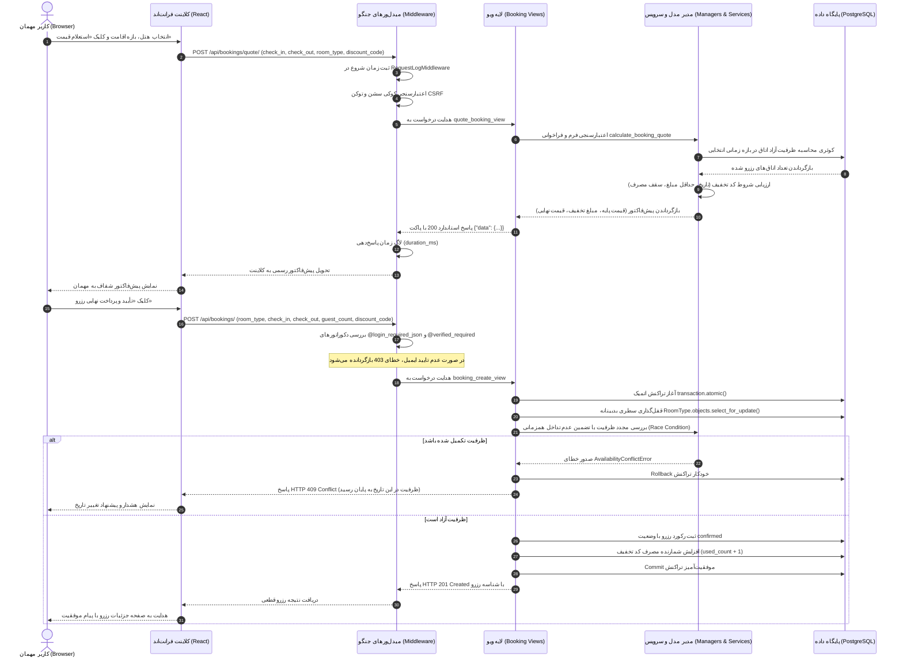

# بخش اول گزارش نهایی: معماری کلان و دیاگرام‌های سیستم (Overall Architecture & Diagrams)

## ۱. نمای کلی سیستم و پشته فناوری (System Overview & Tech Stack)

سامانه رزرواسیون هتل یک برنامه کاربردی تحت وب چندکاربره (Multi-Role Web Application) است که به صورت معماری کلاینت-سرور جداشده (Decoupled Client-Server) طراحی و پیاده‌سازی شده است. سیستم به دو نقش اصلی **مدیر هتل (Hotel Manager)** و **مهمان (Guest)** به همراه کاربران ناشناس و مدیر ارشد سیستم (Superadmin) خدمات ارائه می‌دهد.

### جدول پشته فناوری (Technology Stack)

| لایه سیستم | فناوری انتخاب‌شده | نسخه / ابزار | دلیل انتخاب و ویژگی‌های فنی |
|---|---|---|---|
| **Frontend (کلاینت)** | React SPA | React 18 + Vite | معماری تک‌صفحه‌ای سبک، سریع و ماژولار بدون وابستگی به TypeScript (جاوااسکریپت خالص طبق الزامات درس) |
| **Styling & UI** | Tailwind CSS | Tailwind v3 | طراحی واکنش‌گرا (Responsive) سازگار با استانداردهای راست‌به‌چپ (RTL) و قلم استاندارد وزیرمتن (Vazirmatn) |
| **Backend (وب‌سرویس)** | Django | Python 3.12 + Django 5.x | وب‌ویوهای صریح جنگو (Plain Views) مبتنی بر فرم‌های اعتبارسنجی (`Django Forms`) بدون استفاده از فریم‌ورک‌های سنگین خارجی مانند DRF |
| **پایگاه داده (DB)** | PostgreSQL | PostgreSQL 16 | پایگاه داده رابطه‌ای قدرتمند، پشتیبانی از قفل‌گذاری سطری بدبینانه (`SELECT FOR UPDATE`)، قیود جامعیت داده‌ها (`CheckConstraint`, `UniqueConstraint`) و تراکنش‌های اتمیک |
| **احراز هویت و امنیت** | Django Session Auth | Session Cookie + CSRF | استفاده از کوکی‌های ایمن سشن (`HttpOnly`, `SameSite=Lax`) و توکن‌های محافظت از حمله جعل درخواست میان‌وب‌گاهی (`CSRF`) |
| **تایید هویت ایمیل** | Stateless Signed Tokens | `django.core.signing.TimestampSigner` | اعتبارسنجی بدون حالت و ۴۸ ساعته با امضای رمزنگاری‌شده بدون نیاز به ایجاد جداول سربار در پایگاه داده |
| **مدیریت لاگ و مانیتورینگ** | Python Logging | File & Stream Handlers | جداسازی کانال‌های لاگ امنیتی (`apps.security`)، لاگ عمومی درخواست‌ها (`apps.core.middleware`) و رهگیری رخدادهای تجاری |

---

## ۲. دیاگرام معماری لایه‌ای سیستم (Layered System Architecture)

معماری سامانه بر مبنای تفکیک دقیق وظایف (Separation of Concerns) در ۵ لایه مجزا سازمان‌دهی شده است:

```mermaid
flowchart TD
    subgraph ClientLayer["۱. لایه کلاینت (Presentation Layer - React SPA)"]
        UI_Guest["پنل مهمان (جستجو، پیش‌فاکتور، ثبت رزرو، تاریخچه)"]
        UI_Manager["پنل مدیریت هتل (افزودن هتل، تعریف انواع اتاق، تقویم و گزارش رزروها)"]
        UI_Auth["ماژول احراز هویت و تایید ایمیل (ورود، ثبت‌نام، بنر تایید ایمیل)"]
        API_Client["کلاینت ارتباطی Fetch API (مدیریت خودکار CSRF Token، خطایابی یکپارچه)"]
    end

    subgraph GatewayLayer["۲. لایه کنترل و امنیت (Security & Middleware Layer)"]
        MW_Log["RequestLogMiddleware (ثبت شناسه کاربر، متد، مسیر، کد وضعیت و زمان پردازش ms)"]
        MW_Session["SessionMiddleware (بارگذاری و اعتبارسنجی کوکی نشست کاربر)"]
        MW_CSRF["CsrfViewMiddleware (محافظت در برابر حملات Cross-Site Request Forgery)"]
        DEC_Auth["دکوراتور login_required_json (بررسی ورود، پاسخ 401 استاندارد)"]
        DEC_Role["دکوراتور role_required (بررسی نقش کاربر، پاسخ 403 استاندارد)"]
        DEC_Verified["دکوراتور verified_required (بررسی تایید ایمیل در تراکنش‌های حساس، پاسخ 403)"]
    end

    subgraph AppViewLayer["۳. لایه منطق وب و کنترلرها (Application & Views Layer)"]
        V_Accounts["apps.accounts (احراز هویت، ثبت‌نام، خروج، /me/، تایید ایمیل و ارسال مجدد)"]
        V_Hotels["apps.hotels (کاتالوگ هتل‌ها، جستجوی بلادرنگ، CRUD هتل و اتاق با تفکیک مالکیت 404)"]
        V_Bookings["apps.bookings (استعلام قیمت، اعتبارسنجی کدهای تخفیف، ثبت و لغو اتمیک رزرو)"]
        V_Core["apps.core (هندلرهای خطای 400/401/403/404/500، پاکت پاسخ استاندارد JSON)"]
    end

    subgraph DomainLayer["۴. لایه دامنه و مدل‌های سفارشی (Domain & Custom Managers Layer)"]
        M_User["UserManager & User Model (مدیریت کاربران، فیلتر guests/managers)"]
        M_Hotel["HotelQuerySet & Hotel Model (فیلترهای active/city/price، واکشی بهینه select_related)"]
        M_Booking["BookingQuerySet & Booking Model (محاسبه تداخل بازه‌ها، رزروهای فعال/لغوشده)"]
        M_Service["Availability Service & Pricing Engine (سنجش ظرفیت، محاسبه پیش‌فاکتور و تخفیف)"]
    end

    subgraph PersistenceLayer["۵. لایه پایگاه داده و ذخیره‌سازی (Data Persistence Layer)"]
        DB_Postgres[("پایگاه داده PostgreSQL\n(جداول اصلی، قفل‌گذاری سطری select_for_update)")]
        DB_Session[("جدول django_session\n(نشست‌های پایدار کاربر در دیتابیس)")]
        File_Logs[("فایل‌های لاگینگ سرور\n(logs/security.log, logs/app.log)")]
        Email_Backend["سیستم ارسال ایمیل جنگو\n(Console Backend / SMTP)"]
    end

    ClientLayer -->|"درخواست‌های HTTP REST با پاکت JSON"| GatewayLayer
    GatewayLayer -->|"پایش امنیت و دسترسی‌ها"| AppViewLayer
    AppViewLayer -->|"اعتبارسنجی با فرم‌ها و فراخوانی مدیران"| DomainLayer
    DomainLayer -->|"اجرای تراکنش‌های اتمیک و کوئری‌های بهینه"| PersistenceLayer
```

---

## ۳. چرخه حیات درخواست سراسری (End-to-End Request/Response Lifecycle)

دیاگرام توالی زیر، جریان یک سناریوی حیاتی در سیستم (استعلام قیمت توسط مهمان، ثبت قطعی رزرو و ثبت رخدادها) را از لحظه کلیک کاربر تا ذخیره‌سازی در پایگاه داده و بازگشت پاسخ نشان می‌دهد:

---

## ۴. تفکیک نقش‌ها و ماتریس سطوح دسترسی (Role-Based Access Matrix)

سیستم دسترسی‌ها را بر اساس مدل مبتنی بر نقش (Role-Based Access Control) مدیریت می‌کند:

| بخش و ماژول سیستم | کاربر ناشناس (Anonymous) | کاربر مهمان (Guest) | مدیر هتل (Manager) | مدیر ارشد (Superadmin) |
|---|:---:|:---:|:---:|:---:|
| **مشاهده کاتالوگ و جستجوی هتل‌ها** | مجاز (Public) | مجاز | مجاز | مجاز |
| **مشاهده جزئیات هتل و اتاق‌ها** | مجاز (Public) | مجاز | مجاز | مجاز |
| **استعلام قیمت و پیش‌فاکتور** | مجاز (Public) | مجاز | مجاز | مجاز |
| **ثبت‌نام و ایجاد حساب کاربری** | مجاز | – | – | مجاز |
| **ورود، خروج و بررسی سشن (`/me/`)** | ورود/ثبت‌نام | مجاز | مجاز | مجاز |
| **تایید ایمیل و درخواست مجدد لینک** | مجاز با توکن | مجاز | مجاز | مجاز |
| **ثبت قطعی رزرو اتاق** | نیازمند ورود (۴۰۱) | مجاز (ایمیل تاییدشده) | ممنوع (۴۰۳) | مجاز |
| **مشاهده تاریخچه رزروهای شخصی** | ممنوع (۴۰۱) | مجاز | ممنوع (۴۰۳) | مجاز |
| **لغو رزروهای شخصی (پیش از موعد)** | ممنوع (۴۰۱) | مجاز | ممنوع (۴۰۳) | مجاز |
| **ایجاد، ویرایش و حذف هتل** | ممنوع (۴۰۱) | ممنوع (۴۰۳) | مجاز (فقط هتل‌های خود) | دسترسی کامل |
| **تعریف انواع اتاق و تعیین قیمت** | ممنوع (۴۰۱) | ممنوع (۴۰۳) | مجاز (فقط هتل‌های خود) | دسترسی کامل |
| **ایجاد و مدیریت کدهای تخفیف** | ممنوع (۴۰۱) | ممنوع (۴۰۳) | مجاز (فقط هتل‌های خود) | دسترسی کامل |
| **مشاهده تقویم و ماتریس ظرفیت هتل** | ممنوع (۴۰۱) | ممنوع (۴۰۳) | مجاز (فقط هتل‌های خود) | دسترسی کامل |
| **مشاهده لیست رزروهای ورودی هتل** | ممنوع (۴۰۱) | ممنوع (۴۰۳) | مجاز (فقط هتل‌های خود) | دسترسی کامل |
| **پنل مدیریت جنگو (`/admin/`)** | ممنوع (۴۰۳/Redirect) | ممنوع (۴۰۳) | ممنوع (بدون دسترسی Staff) | دسترسی کامل |

---

## ۵. امنیت و تدابیر ضد نفوذ در معماری

1. **جلوگیری از حدس‌زدن شناسه‌ها (Anti-Enumeration Protection):** در صورتی که مدیر هتل قصد دسترسی، ویرایش یا حذف منبع متعلق به مدیر دیگری را داشته باشد، سیستم به جای خطای ۴۰۳، پاسخ **404 Not Found** ارسال می‌کند تا از وجود شناسه هتل یا اتاق در سیستم اطلاعی نشت پیدا نکند.
2. **عدم ذخیره‌سازی داده‌های حساس در لاگ‌ها (Hard Rule 9):** کلمات عبور، کلیدهای کامل سشن و محتوای حساس به هیچ عنوان لاگ نمی‌شوند؛ در لاگ‌های امنیتی تنها شناسه کاربر، متد، مسیر و آدرس IP ثبت می‌گردد.
3. **حفاظت در برابر شرایط مسابقه (Race Condition):** قفل سطری PostgreSQL بر روی جدول `RoomType` به همراه تراکنش‌های `atomic` مانع از رزرو همزمان بیش از ظرفیت (Overbooking) توسط چند کاربر همزمان می‌شود.
4. **توکن‌های بدون حالت با امنیت بالا:** توکن‌های تایید ایمیل به کمک الگوریتم امضای هش با کلید رمز (`SECRET_KEY`) و سالت اختصاصی تولید شده و انقضای ۴۸ ساعته آن‌ها بدون وابستگی به دیتابیس به صورت ریاضی ارزیابی می‌شود.
