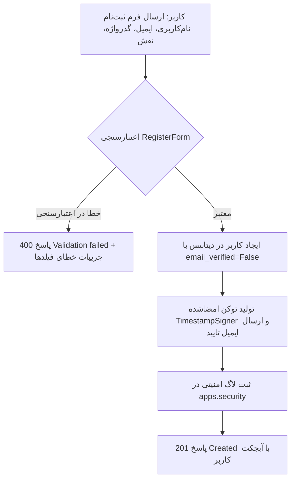
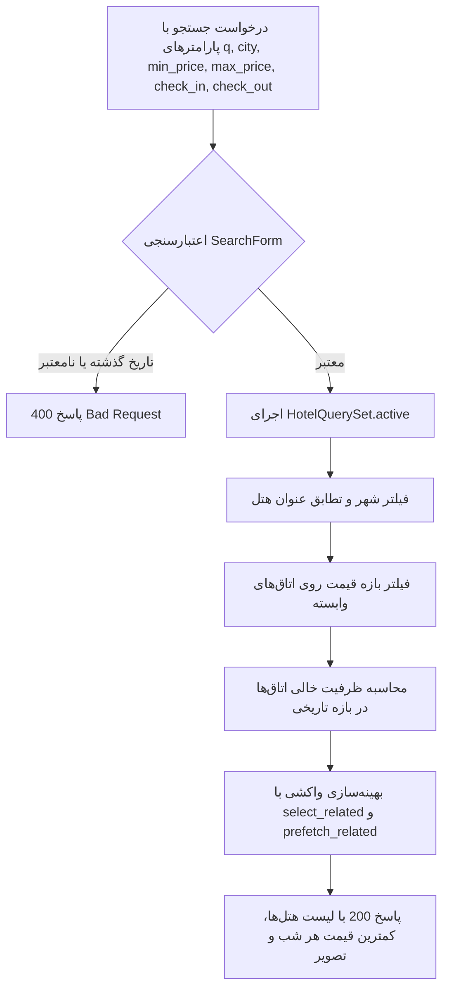
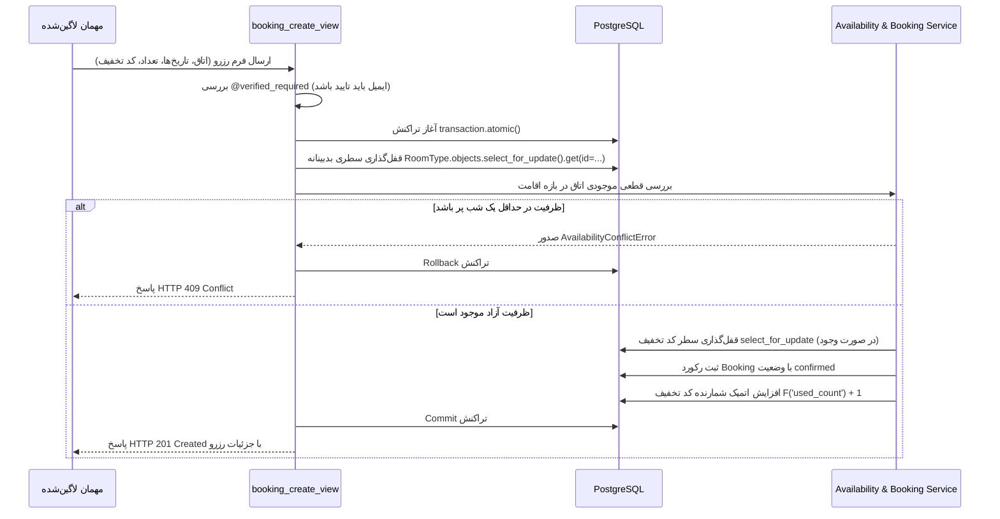

# بخش دوم گزارش نهایی: تحلیل فرآیندها به تفکیک برنامه‌های جنگو (Process per Django App)

این بخش به تشریح گام‌به‌گام فرآیندها، جریان داده‌ها و منطق تجاری در هر یک از چهار برنامه اصلی وب‌سرویس جنگو (`core`، `accounts`، `hotels`، `bookings`) به تفکیک نقش‌های کاربری (کاربر مهمان، مدیر هتل، کاربر ناشناس و سیستم) می‌پردازد.

---

## ۱. برنامه هسته و زیرساخت (`apps.core`)

### ۱.۱. مسئولیت‌ها و مرزهای برنامه
برنامه `core` وظیفه فراهم‌سازی زیرساخت مشترک، میدل‌ورهای امنیتی و مانیتورینگ، توابع استانداردسازی پاکت پاسخ JSON، دکوراتورهای اعتبارسنجی سطوح دسترسی و میزبانی اپلیکیشن تک‌صفحه‌ای React (SPA Host) را بر عهده دارد. طبق قوانین معماری پروژه، `core` به هیچ‌یک از برنامه‌های دیگر وابستگی مستقیم ندارد.

### ۱.۲. خط لوله پردازش درخواست‌ها (Request Middleware Pipeline)
هنگام ورود هر درخواست HTTP به سرور:
1. **ثبت لاگ و زمان‌سنجی (`RequestLogMiddleware`):** زمان ورود درخواست ثبت شده و پس از اتمام پردازش، متد HTTP، مسیر URL، کد وضعیت پاسخ، شناسه کاربر لاگین‌شده (یا `anon`) و مدت زمان پردازش به میلی‌ثانیه (`duration_ms`) در لاگر `apps.core.middleware` ذخیره می‌شود. درخواست‌های بیش از ۵۰۰ میلی‌ثانیه به عنوان اخطار کندی ثبت می‌شوند.
2. **مدیریت نشست (`SessionMiddleware`):** کوکی نشست امن کاربر واکشی و داده‌های سشن از جدول دیتابیس بازخوانی می‌شوند.
3. **محافظت CSRF (`CsrfViewMiddleware`):** برای متدهای تغییردهنده وضعیت (POST, PUT, DELETE)، هدر `X-CSRFToken` با مقدار توکن کوکی مقایسه و اعتبارسنجی می‌شود.

### ۱.۳. دکوراتورهای امنیتی و کنترل دسترسی
- **`@login_required_json`:** احراز هویت را بررسی کرده و در صورت ناشناس بودن کاربر، پاسخ یکپارچه `HTTP 401 Unauthorized` با پیام `"Authentication required."` بازمی‌گرداند.
- **`@role_required(*allowed_roles)`:** نقش کاربر (`request.user.role`) را ارزیابی می‌کند. در صورت عدم احراز هویت کد ۴۰۱ و در صورت عدم تطابق نقش با لیست مجاز، پاسخ `HTTP 403 Forbidden` با پیام `"Permission denied."` ارسال و رخداد در `apps.security` لاگ می‌شود.
- **`@verified_required(methods=[...])`:** وضعیت تایید ایمیل کاربر (`request.user.email_verified`) را می‌سنجد. این دکوراتور از فیلتر متدهای HTTP پشتیبانی می‌کند؛ به عنوان نمونه برای ایجاد هتل یا رزرو اتاق با متد `POST` خطای ۴۰۳ صادر می‌کند، اما متد `GET` جهت بررسی لیست هتل‌ها بدون مانع عبور داده می‌شود.

### ۱.۴. ساختار استاندارد پاکت پاسخ‌های JSON
تمام پاسخ‌های ارسالی از API از الگوی قراردادی یکنواخت پیروی می‌کنند:
- **پاسخ موفق:** `{"data": {...}}` با کد وضعیت 200 یا 201.
- **پاسخ خطا:** `{"message": "شرح خطا", "errors": {"field": ["خطا"]}}` با کدهای 400، 401، 403، 404، 409 یا 500.

---

## ۲. برنامه مدیریت حساب‌ها و احراز هویت (`apps.accounts`)

### ۲.۱. مسئولیت‌ها و مدل هویتی
این برنامه وظیفه ثبت‌نام کاربران، احراز هویت نشست‌محور (Session-based)، تخصیص نقش (`guest` یا `manager`)، مدیریت نشست‌های ماندگار (`remember_me`) و سرویس تایید ایمیل بدون حالت (Stateless Verification) را بر عهده دارد.

### ۲.۲. فرآیندهای گام‌به‌گام

#### الف) فرآیند ثبت‌نام کاربر جدید (`POST /api/auth/register/`)

1. کاربر داده‌های فرم را ارسال می‌کند. نام کاربری و ایمیل از نظر یکتایی بررسی می‌شوند.
2. گذرواژه از نظر پیچیدگی (طول، تطابق تکرار گذرواژه) اعتبارسنجی و به صورت امن هش (PBKDF2) می‌شود.
3. رکورد کاربر با وضعیت `email_verified=False` در جدول `accounts_user` ذخیره می‌شود.
4. سیستم به طور خودکار توکن تایید ایمیل را تولید و از طریق سرویس ایمیل برای کاربر ارسال می‌کند.

#### ب) فرآیند تایید ایمیل با توکن رمزشده (`POST /api/auth/verify-email/`)
1. مهمان یا مدیر روی پیوند ارسالی در ایمیل کلیک می‌کند (`/verify-email?token=<token>`).
2. کلاینت توکن را به اندپوینت تایید ارسال می‌نماید.
3. تابع `verify_token`:
   - امضای توکن را با کلید مخفی و سالت اختصاصی ارزیابی می‌کند (`BadSignature` -> خطای ۴۰۰).
   - سن مهر زمانی توکن را می‌سنجد (`max_age=172800` معادل ۴۸ ساعت؛ در صورت انقضا -> خطای ۴۰۰).
   - شناسه کاربر را استخراج و در صورت حذف کاربر، خطای ۴۰۰ صادر می‌کند.
4. فیلد `email_verified = True` در دیتابیس ذخیره شده و موفقیت عملیات در `apps.security` ثبت می‌گردد.

#### ج) فرآیند ورود به سامانه و مدیریت نشست (`POST /api/auth/login/`)
1. کاربر نام‌کاربری یا ایمیل خود را به همراه گذرواژه ارسال می‌کند (`LoginForm`).
2. سیستم شناسه را به صورت غیرحساس به حروف بزرگ و کوچک (Case-Insensitive) با رکورد کاربر تطبیق می‌دهد.
3. در صورت فعال بودن گزینه `remember_me`، انقضای نشست روی ۲ هفته (`set_expiry(1209600)`) و در غیر این صورت روی انقضا با بستن مرورگر (`set_expiry(0)`) تنظیم می‌شود.
4. تابع `django.contrib.auth.login` شناسه کاربر را در نشست ذخیره کرده و ردیف سشن در دیتابیس نوشته می‌شود.
5. زمان ورود (`last_login`) در جدول سشن ذخیره شده و در پاسخ بازگردانده می‌شود.

#### د) فرآیند دریافت وضعیت کاربر جاری (`GET /api/auth/me/`)
- در صورت ورود کاربر: آبجکت مشخصات (`id`, `username`, `email`, `role`, `email_verified`, `last_login`) با کد ۲۰۰ بازگردانده می‌شود.
- در صورت ناشناس بودن: پاسخ معتبر `{"data": null}` با کد ۲۰۰ ارسال می‌گردد تا فرانت‌اند وضعیت ورود را تشخیص دهد.

#### ه) فرآیند خروج از سامانه (`POST /api/auth/logout/`)
- درخواست با دکوراتور `@login_required_json` محافظت شده است.
- متد `request.session.flush()` سشن کاربر را از حافظه و جدول پایگاه‌داده به طور کامل پاکسازی می‌کند.

---

## ۳. برنامه هتل‌ها و انواع اتاق (`apps.hotels`)

### ۳.۱. مسئولیت‌ها و مدل داده
این برنامه مسئولیت ذخیره مشخصات هتل‌ها (`Hotel`)، امکانات رفاهی (`Amenity`) و انواع اتاق (`RoomType`) را به همراه خدمات جستجو برای مهمانان و پنل مدیریت CRUD برای مدیران بر عهده دارد.

### ۳.۲. فرآیندهای عمومی و مهمان (Public / Guest Flows)

#### الف) فرآیند جستجو و فیلتر هتل‌ها (`GET /api/hotels/`)

1. پارامترهای ارسالی در `SearchForm` بررسی می‌شوند (عدم انتخاب تاریخ ورود در گذشته و رعایت `check_out > check_in`).
2. فیلترها روی متدهای زنجیره‌ای `HotelQuerySet` (`active()`, `by_city()`, `by_price_range()`, `search()`) اعمال می‌شوند.
3. جهت جلوگیری از مشکل کارایی N+1، هتل‌ها همراه با مالک و امکانات با متدهای `select_related("owner")` و `prefetch_related("room_types__amenities")` واکشی می‌شوند.

#### ب) مشاهده جزئیات هتل و اتاق‌ها (`GET /api/hotels/<id>/`)
- اطلاعات کامل هتل همراه با انواع اتاق‌های موجود بازگردانده می‌شود.
- در صورت فعال بودن نشست، شناسه هتل به عنوان آخرین هتل‌های مشاهده‌شده (`recent_hotels`) در سشن مهمان نگهداری می‌شود تا در صفحه اصلی دسترسی سریع فراهم باشد.

### ۳.۳. فرآیندهای اختصاصی مدیر هتل (Manager CRUD Flows)

#### الف) ایجاد و ویرایش هتل (`POST / PUT /api/manager/hotels/`)
1. دسترسی با دکوراتورهای `@role_required("manager")` و `@verified_required(methods=["POST"])` بررسی می‌شود.
2. فرم `HotelForm` اطلاعات ارسالی (نام، شهر، آدرس، امتیاز ستاره) را اعتبارسنجی می‌کند.
3. فیلد `owner` به طور خودکار برابر با مدیر واردشده (`request.user`) تنظیم می‌شود.

#### ب) تفکیک مالکیت و جلوگیری از افشای داده‌ها (Ownership 404 Guard)
- در تمامی عملیات ویرایش (`PUT`)، مشاهده جزئیات (`GET`) یا حذف (`DELETE`) هتل یا نوع اتاق:
  ```python
  hotel = get_object_or_404(Hotel.objects.filter(owner=request.user), id=hotel_id)
  ```
- **تدبیر امنیتی:** اگر مدیر A شناسه هتل مدیر B را درخواست کند، سیستم خطای **404 Not Found** صادر می‌کند تا مهاجم نتواند با حدس زدن شناسه‌ها، ساختار داده‌های دیگران را بررسی کند.

#### ج) مدیریت انواع اتاق (`/api/manager/hotels/<id>/room-types/`)
- مدیر نوع اتاق جدید (عنوان، ظرفیت، قیمت هر شب و تعداد اتاق فیزیکی موجود) را ثبت و امکانات رفاهی (`Amenity`) را به آن متصل می‌کند.
- عنوان اتاق درون یک هتل با قود یکتایی `unique_together = [("hotel", "title")]` محافظت می‌شود.

---

## ۴. برنامه رزرواسیون و تخفیف‌ها (`apps.bookings`)

### ۴.۱. مسئولیت‌ها و هسته محاسباتی سیستم
برنامه `bookings` قلب تپنده تجاری سیستم است که وظایف زیر را به انجام می‌رساند:
- استعلام قیمت و پیش‌فاکتور پویا
- کنترل تداخل تاریخ‌ها و مدیریت جابجایی روزانه (Same-day Turnover)
- جلوگیری از رزرو مازاد بر ظرفیت (Overbooking) با قفل سطری PostgreSQL
- اعتبارسنجی و اعمال کدهای تخفیف با قوانین چندگانه
- ثبت قطعی و لغو اتمیک با احیای ظرفیت و سهمیه تخفیف
- ارائه ماتریس و تقویم ظرفیت هتل به مدیر

### ۴.۲. فرآیندهای گام‌به‌گام

#### الف) استعلام قیمت و بررسی ظرفیت (`POST /api/bookings/quote/`)
1. مهمان تاریخ‌های ورود و خروج، تعداد اتاق و کد تخفیف اختیاری را ارسال می‌کند.
2. سامانه موجودی فعال اتاق را در تمام روزهای بازه ارزیابی می‌کند:
   - شرط تداخل دو رزرو: `check_in < req_out AND check_out > req_in`.
   - به دلیل ساعت خروج ۱۲ ظهر و ورود ۱۴ بعدازظهر، خروج در همان روز ورودِ مهمان بعدی (`req_in == exist_out`) مجاز بوده و تداخل محسوب نمی‌شود (Same-day Turnover).
3. در صورت وجود ظرفیت، قیمت پایه به فرمول `تعداد شب‌ها × قیمت هر شب × تعداد اتاق` محاسبه می‌شود.
4. در صورت ورود کد تخفیف، اعتبارسنجی شروط در `calculate_discount` انجام می‌پذیرد:
   - وضعیت فعال بودن (`is_active=True`)
   - بازه زمانی اعتبار (`valid_from <= today <= valid_to`)
   - سقف دفعات استفاده (`used_count < max_uses`)
   - حداقل مبلغ رزرو (`subtotal >= min_booking_amount`)
   - انطباق با هتل انتخاب‌شده (کوپن هتل دیگر رد می‌شود)
5. پیش‌فاکتور رسمی با تفکیک قیمت کل، سود تخفیف و مبلغ نهایی تولید می‌شود.

#### ب) ثبت نهایی و قطعی رزرو (`POST /api/bookings/`)


#### ج) لغو رزرو اقامت (`POST /api/bookings/<id>/cancel/`)
1. مهمان درخواست لغو رزرو شخصی خود را ارسال می‌کند.
2. بررسی مالکیت: مهمان تنها می‌تواند رزروهای شخص خود را لغو کند (`user=request.user`)؛ در غیر این صورت خطای ۴۰۴ بازگردانده می‌شود.
3. بررسی امکان لغو: رزرو نباید از قبل لغو شده باشد و تاریخ ورود نباید در گذشته باشد.
4. تراکنش اتمیک لغو:
   - وضعیت رزرو به `cancelled` تغییر می‌یابد.
   - ظرفیت اتاق فیزیکی به طور خودکار برای سایر مهمانان آزاد می‌شود.
   - در صورت استفاده از کد تخفیف با سقف محدود، شمارنده `used_count` کد تخفیف با یک واحد کاهش اتمیک احیا می‌شود (`F('used_count') - 1`) تا مهمان دیگری بتواند از آن استفاده کند.

#### د) گزارش رزروها و تقویم ظرفیت برای مدیر هتل
- مدیر هتل از طریق `/api/manager/hotels/<id>/bookings/` لیست رزروهای مهمانان را همراه با فیلتر وضعیت (`confirmed`, `cancelled`) مشاهده می‌کند.
- از طریق `/api/manager/hotels/<id>/availability/?start_date=...&end_date=...` ماتریس روزانه ظرفیت برای هر نوع اتاق (`total_rooms`, `reserved_rooms`, `free_rooms`) محاسبه و نمایش داده می‌شود.
